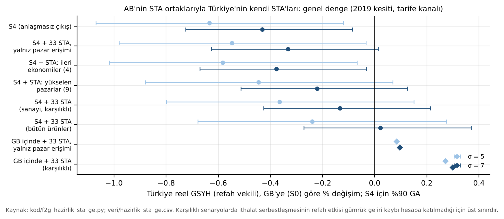
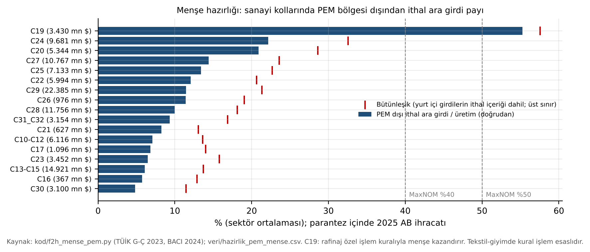
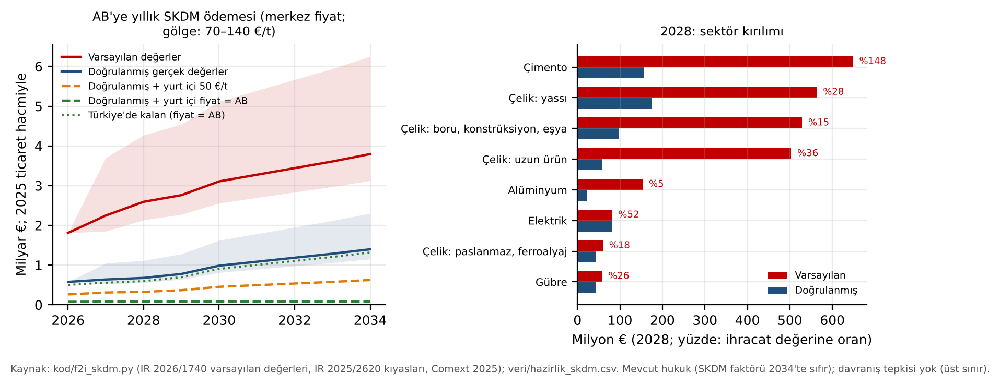
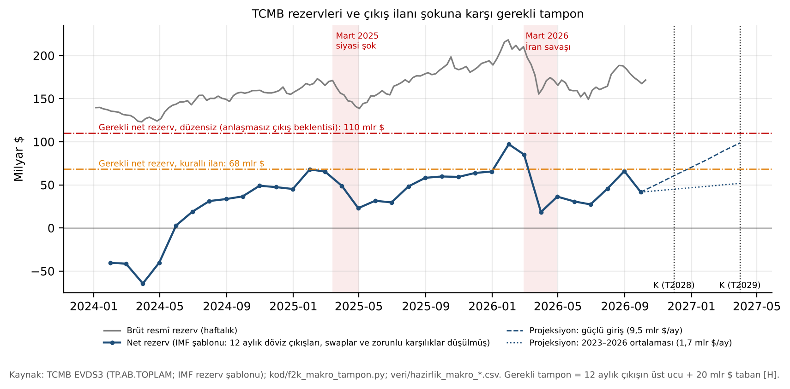
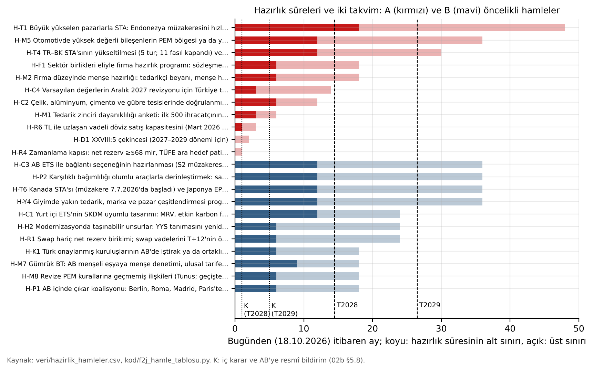

# Faz 2C — Karar öncesi hazırlık: sessiz, pişmanlıksız hamleler

**Durum:** Faz 2 / 9'un üçüncü kısmı tamamlandı (18 Ekim 2026); DEVAM bekleniyor. Önceki kısımlar: [`02a_politika_uzayi.md`](02a_politika_uzayi.md), [`02b_secenekler_hukuk.md`](02b_secenekler_hukuk.md). Defter: [`defter.md`](defter.md).

**Bu belge ne yapıyor?** Soru şu: Türkiye, GB'den çıkış kararını almadan ve ilan etmeden önce, sessizce neler yapabilir ki çıkış olursa faydası en yüksek olsun? Belge:
- dokuz çerçevede 51 hamleyi tanımlıyor ve puanlıyor: hukuk (AB/GB, DTÖ, iç hukuk), ticaret anlaşmaları, menşe ve gümrük, kalite altyapısı, sanayi ve yatırım, karbon (SKDM), makro-finans, diplomasi, firma düzeyi;
- dört hamle grubunun değerini sayısal olarak ölçüyor: STA ağı (genel denge), menşe riski, SKDM yükü ve makro tampon (§3, §4, §7, §8);
- yapılmaması gerekenleri kırmızı listede topluyor (§11);
- iki takvim için devreye alma sırasını öneriyor (§13).

Kanıt etiketleri ve güven düzeyleri 02a'daki gibi.

**"Sessiz hamle" nedir?** Dört ölçüt aynı anda sağlanmalı:
1. **Hukuka uygun:** GB (1/95), DTÖ ve Türk iç hukuku içinde. Gri alandakiler işaretli; aykırı olanlar kırmızı listede.
2. **Çift gerekçeli:** çıkıştan bağımsız, kamuya söylenebilir ve doğru bir gerekçesi var. Örnekler: GB modernizasyonu, 1/95 md. 16 uyumu, SKDM uyumu, IMF'nin rezerv tavsiyesi, OVP 2027–2029 hedefleri.
3. **Tek başına çıkış sinyali vermiyor.** Görünürlük ölçeği:
   - Düşük: iç çalışma, kapalı toplantı, teknik süreç.
   - Orta: kamuya açık ama rutin; ör. DTÖ bildirimi, STA turu, ETS kararı.
   - Yüksek: çıkışa özgü; bunlar karar gününe bırakılır.
4. **Pişmanlıksız:** çıkış olmasa da değeri sıfırın altında değil. Çoğunun değeri pozitif.

**Veri ve kod.**

| Betik | İçerik | Ana kaynak |
|---|---|---|
| `kod/f2g_hazirlik_sta_ge.py` | AB'nin STA ortaklarıyla Türkiye'nin kendi STA'ları: genel denge (S0 ve S4 üzerine) | Faz 2B GE modülü (`kod/f2f_cekim_modeli.py`), WITS, BACI 2024, 2026 Türk tarifesi |
| `kod/f2h_mense_pem.py` | Sanayi kollarında ve kilit ürünlerde PEM dışı girdi payı | TÜİK 2023 ithalat G-Ç tablosu, BACI 2024, PRODTR 2025 |
| `kod/f2i_skdm.py` | SKDM yükü: varsayılan ve doğrulanmış değer, yurt içi karbon fiyatı, aşağı akış genişlemesi | Uygulama Tüzükleri 2026/1740 ve 2025/2620, Comext 2025 |
| `kod/f2k_makro_tampon.py` | Rezerv tamponu, ilan şoku, zamanlama kapısı | TCMB EVDS3 (rezerv şablonu, haftalık rezerv) |
| `kod/f2j_hamle_tablosu.py` | 51 hamlenin puanlanması ve öncelik sırası | `veri/hazirlik_hamleler.csv` (elle derlendi) |

Hukuki ve kurumsal bulgular bu fazın dört araştırma notundan alındı: AB/GB hukuku ve emsaller; Türk hukuku, STA'lar ve kurumlar; SKDM; makro-finans. `[V]` etiketli olanlar birincil metinden okundu: EUR-Lex, DTÖ G/MA belgeleri, mevzuat.gov.tr, Resmî Gazete, TCMB, IMF, Ticaret Bakanlığı. Elle derlenen girdiler `veri/skdm_*.csv` ve `veri/hazirlik_hamleler.csv`'de, kaynak sütunlarıyla.

---
## Faz 2C'nin 12 ana bulgusu

1. **Hazırlık alanı geniş, pencere dar.**
   - 51 hamle tanımlandı: 11'i A (hemen başlat), 26'sı B (karar öncesi başlat), 14'ü C.
   - Hepsi hukuka uygun ve çift gerekçeli. Hiçbirinin çıkış olmadığında değeri negatif değil; A'ların 10'u çıkış olmasa da yüksek değerli.
   - Sessiz pencere, yani bugünden karar gününe (K) kalan süre: T2028'de ≈1 ay, T2029'da ≈5 ay. Uzun süreli hamlelerin hiçbiri K'ye kadar bitmiyor, ama hepsi başlatılabiliyor.
   - `[H]` Güven: Orta.
2. **İki son tarih bu yıl içinde.**
   - **XXVIII:5 çekincesi, 31.12.2026.**
     - Türkiye 2012–2014 ve 2021–2023 için çekince koymuştu, 2024–2026 için koymadı.
     - AB ve BK 2027–2029 için çekincelerini koydu (G/MA/446, 452).
     - BK aynı aracı Brexit'ten önce kullandı (G/MA/357).
   - **2027 bütçesinde geçiş tamponu.**
   - `[V]` Güven: Yüksek.
3. **Bağlayıcı kısıt makro-finans.**
   - Net rezerv (IMF şablonu) $41,6 mlr. Kurallı bir çıkış ilanı için $68 mlr, düzensiz senaryo için $110 mlr gerekiyor.
   - T2028 bu kapıdan geçmiyor. T2029 ancak Mart–Ağustos 2026'daki gibi güçlü girişlerle ve kurallı bir ilanla geçiyor.
   - Kurdaki %10'luk artış TÜFE'yi ≈250 bp yükseltir; bu, TÜFE kısıtının sekiz katı. Rezerv tamponu TÜFE kısıtının ön şartı.
   - `[T]` Güven: Düşük–Orta.
4. **Kendi STA ağı S4 kaybının bir kısmını telafi eder.**
   - AB'nin STA ortağı olan 33 pazarla STA, S4'ün GSYH kaybının %14–23'ünü (yalnız pazar erişimi) ile %42–69'unu (karşılıklı) telafi ediyor.
   - En değerli grup yükselen pazarlar: Hindistan, Endonezya, Meksika, Mercosur, GAGB (Güney Afrika), Vietnam.
   - Bunların çoğuyla müzakere yok. Türkiye–BK STA'sının yükseltilmesi ve Kanada müzakereleri sürüyor.
   - GB içinde bile değerli: GSYH'ye +%0,08–0,30. Gümrük geliri kaybı yılda ≈$1,9 mlr.
   - `[T]` Güven: Orta.
5. **Menşe riski kuyrukta.**
   - Ortalama sanayi kolu PEM değer kurallarını rahat karşılıyor: PEM dışı girdi payı %13.
   - Risk iki ürün grubunda:
     - **Otomobil:** gösterge %36, kural %45. BK'den motor ithalatı $1,4 mlr.
     - **Giyim:** çift dönüşüm kuralı. İhracatın %10–15'i Asya kumaşına dayanıyor.
   - En yüksek getirili sessiz hamle menşe veri altyapısı: ürün ağacı ve tedarikçi beyanı (H-M1, H-M2).
   - `[T]` Güven: Orta (sektör), Düşük (ürün).
6. **SKDM'de hazırlıksızlığın bedeli yılda €1,2–2,4 milyar.**
   - Türkiye'nin varsayılan değerleri yüksek fırın düzeyinde. Çimentoya ise en kötü on ülkenin ortalaması uygulanıyor.
   - AB'ye ödeme 2028'de varsayılan değerlerle €2,6 mlr, doğrulanmış verilerle €0,7 mlr.
   - Yurt içi karbon fiyatı AB'ninkine eşit olur ve ücretsiz tahsis AB kurallarını aşmazsa, €0,6–1,3 mlr Türk bütçesinde kalır.
   - Bu hamleler GB'den bağımsız, tam pişmanlıksız.
   - `[T]` Güven: Orta.
7. **SKDM'nin aşağı akış genişlemesi önerisi T2028 ile aynı gün başlıyor (1.1.2028).**
   - Taşıt ve beyaz eşya dahil €10,9 mlr ihracat kapsama girebilir.
   - Yük değere oranla küçük (%0,5–3,5); asıl yük veri.
   - Menşe ve karbon hazırlığı aynı veri altyapısını kullanır.
   - `[T]` Güven: Düşük.
8. **Hukuk: çıkışta düşen her aracın taşınabilir bir karşılığı var.**
   - Her iki çıkış yolunda da süren araçlar: AKÇT STA'sı (çelik), Ortak Transit, Tek Belge Sözleşmesi ve PEM.
   - Ortaklık Konseyi kararı yolu ayrıca tarım tercihlerini, yerleşme haklarını ve işçi haklarını koruyor.
   - Bekleyen AB güncellemeleri (YYS karşılıklı tanıması, COM(2026) 477) K'den önce kilitlenmeli. İsviçre emsali gösteriyor ki AB siyasi bir kırılmadan sonra güncellemeleri durdurur.
   - `[V]` Güven: Yüksek (dayanak), Orta (sonuç).
9. **Onaylanmış kuruluş uçurumunu yalnız iki şey kapatır.**
   - Dondurma kararına ve ITA'ya yazılacak bir geçiş hükmü (ya da ACAA).
   - Türk kuruluşlarının AB'de iştirak kurması. BK'nin büyük kuruluşları bunu 2018–2020'de yaptı.
   - TÜRKAK'ın EA üyeliği ise GB'ye bağlı değil.
   - `[V]` Güven: Orta.
10. **İç hukuk hazır; asıl sınırlar tavanlar ve bağlı oranlar.**
    - Tarife, İGV, ÖTV ve KDV Cumhurbaşkanı kararıyla bir gecede değişir (31.12.2020 emsali).
    - Ticaret savunması yavaş: geçici önlem en erken 60 gün sonra, kesin önlem 12–18 ay sonra geliyor. Hazırlık şimdi yapılmalı.
    - Çekmece mevzuatı iç taslak olarak kalmalı. Resmî tasarı, 1/95 md. 57(2) uyarınca Komisyon'la istişareyi gerektirir.
    - `[V]` Güven: Yüksek.
11. **Kırmızı liste uzun ve önemli.** Şunlar AB'ye koruma (md. 58(2)), dengeleme (md. 64) ve Zorlamaya Karşı Araç gerekçesi verir, ITA için gereken güveni de bozar:
    - ortak tarifenin altında örtülü uygulama;
    - AB'nin STA'sı olmayan ülkeye yeni tercih (gri alan; emsalleri var);
    - yerliye özgü vergi indirimi;
    - yerli girdi şartlı teşvik;
    - ticaret önlemini siyasi bir talebe bağlamak ya da bir üye devleti hedef almak;
    - yalnız AB'ye giden mala karbon bedeli.
    - `[V]` Güven: Yüksek.
12. **İlke: "sessiz kur, göstererek kullan."**
    - Kabiliyet sessizce kurulur. K günü bilerek gösterilir: hazır ITA metni, hazır tarife, STA teklifleri, rezerv tamponu.
    - Tam gizlilik ne mümkün ne gerekli. Standart "makul çift gerekçe".
    - `[H]` Güven: Orta.

---

## 1. Çerçeve: hazırlığın değeri, emsaller ve pencere

### 1.1 Hazırlık neden değerli? Üç kanal

1. **Çıkışın maliyetini düşürür.**
   - S4'ün ihracat kaybını STA ağı kısmen telafi eder (§3).
   - S3'ün sonucu menşe hazırlığına bağlı: −%18 ile +%1 arası (02b §2.1).
   - Onaylanmış kuruluş geçiş hükmü sertifika uçurumunu kapatır (§5).
   - Rezerv tamponu ilan şokunu sınırlar (§8).
2. **Pazarlık gücünü artırır.**
   - AB, Türkiye'nin dış seçeneğini ancak gördüğünde fiyatlar: hazır aktif S4, hazır STA teklifleri, rezerv tamponu.
   - Hazırlıksız bir çıkış tehdidi inandırıcı değildir (02b §4.4; §9.3).
3. **Çıkış olmasa da değer üretir.**
   - SKDM hamleleri her durumda yılda €1,2–2,4 mlr kurtarır.
   - STA'lar GB içinde de GSYH'yi artırır.
   - Menşe verisi mevcut 24 STA'dan daha fazla yararlanmayı sağlar.
   - Rezerv birikimini IMF zaten öneriyor.

Karar belirsizken hazırlık bir sigortadır. Faz 2B'nin olasılıklarına göre T2028'de anlaşmasız çıkış %55–68. Sigortanın primi düşük, getirisi asimetrik. A ve B öncelikli hamlelerin hiçbirinin çıkış olmadığında değeri negatif değil (§12).

### 1.2 Emsaller

**Tablo 1.1 — Çıkış ve ayrışma emsalleri: ne yapıldı, ne öğrenildi?**

| Emsal | Hazırlık | Sonuç | Türkiye için ders |
|---|---|---|---|
| **Birleşik Krallık, 2016–2020** | <ul><li>"Süreklilik" anlaşmaları: Mayıs 2020'de 20 anlaşma ve 48 ülke; 29.12.2020'de 62 ülke ve AB</li><li>Kendi tarifesi (BK Küresel Tarifesi, 19.5.2020): satırların %47'si sıfır (AB'nin ortak tarifesinde %27); %2'nin altındaki vergiler kaldırıldı, oranlar yuvarlandı</li><li>Ticaret Çareleri Kurumu: AB'nin 106 önleminden 43'ü devralındı</li><li>XXVIII:5 çekincesi (Aralık 2017) ve DTÖ cetveli taslağı (24.7.2018)</li><li>Anlaşmasız çıkış planlaması (Yellowhammer); en az 6 haftalık ilaç stoku</li><li>Onaylanmış kuruluşların AB'ye taşınması (BSI, LRQA, SGS, UL)</li></ul> | Çıkış anlaşmayla oldu. İlk aylarda tercih kullanım oranı %59–70'te kaldı (02b §5.8) | Hazırlık 2–4 yıl sürdü. En zayıf halka menşe ve belgeleme oldu |
| **İsviçre, 2018–2021** | Kurumsal çerçeve anlaşması görüşmeleri | AB, borsa eşdeğerliğini (Karar 2018/2047) 30.6.2019'da açıkça görüşmelere bağlayarak sona erdirdi. Tıbbi cihaz MRA'sı anlaşma yokluğunda güncellenmedi (26.5.2021) | AB'nin baskı aracı güncellemeleri durdurmak. Bekleyen güncellemeler K'den önce kilitlenmeli (H-M3, H-M4) |
| **Meksika, 2017–2018** | <ul><li>NAFTA yeniden müzakeresi sürerken CPTPP imzası (8.3.2018) ve AB–Meksika ilkesel anlaşması (21.4.2018)</li><li>Banxico'nun $20 mlr'lık kur riski programı</li><li>$88 mlr'lık IMF Esnek Kredi Hattı</li></ul> | USMCA imzalandı (30.11.2018) | Dış seçenek ve finansal tampon pazarlık sürerken kurulur. Çeşitlendirme ile çıkış amacının resmî bağlantısı belgelenemedi `[T]` |
| **Grönland, 1982–1985** | Referandum (23.2.1982); Grönland Antlaşması (13.3.1984; yürürlük 1.2.1985) | Balıkçılık erişimi karşılığında AB pazarına gümrüksüz giriş | Çıkış müzakereyle olabilir. Karşı tarafın çıkar haritası (balıkçılık) pazarlığı belirler (§9) |

*Kaynak:* `[V]` GOV.UK duyuruları (21.10.2019, 20.5.2020, 29.12.2020); BK Küresel Tarifesi (19.5.2020); 2018 Vergi (Sınır Ötesi Ticaret) Kanunu md. 13; G/MA/357; Komisyon bildirimi (22.1.2018) ve 2019 tıbbi cihaz semineri; Karar 2018/2047; DG SANTE bildirimi (26.5.2021); Banxico (21.2.2017, 25.10.2017); IMF (29.11.2017); CELEX 11985G/TXT. Meksika'nın çeşitlendirme gerekçesi `[T]`. Güven: Yüksek (olgular), Orta (dersler).

### 1.3 Pencere ve son tarihler

Karar günü (K), 02b §5.8'e göre:
- T2028'de Kasım 2026;
- T2029'da Mart 2027.

Bugünden K'ye kalan sessiz pencere ≈1 ay ve ≈5 ay. Hamlelerin hazırlık süreleri 0 ile 48 ay arasında (Şekil 2C.5).

**Tablo 1.2 — Takvimdeki sabit tarihler**

| Tarih | Olay | İlgili hamle |
|---|---|---|
| 20.10.2026 | SKDM aşağı akış genişlemesinde ilk üçlü müzakere | H-C5 |
| 27.10.2026 | ETS pilotu: ilk izleme planlarının son günü | H-C1, H-C2 |
| 24.11.2026 | DS629 (Çin–Türkiye) panel raporunun kabulü ya da temyizi için son gün | H-D2 |
| Kasım 2026 | K (T2028) | — |
| Aralık 2026 | 2027 bütçesinin kabulü | H-R3 |
| 31.12.2026 | XXVIII:5 çekincesinin son günü (2027–2029) | H-D1 |
| Mart 2027 | K (T2029) | — |
| 30.9.2027 | 2026 ithalatı için ilk SKDM beyanı ve sertifika teslimi | H-C2 |
| Eylül 2027 | T2029 için AB'nin ITA müzakere yetkisi | H-H4 |
| Aralık 2027 | SKDM varsayılan değerlerinin gözden geçirilmesi | H-C4 |
| 1.1.2028 | T2028; SKDM aşağı akış genişlemesi (kabul edilirse) | H-C5 |
| 1.1.2029 | T2029 | — |

*Kaynak:* `[V]` 02b §5.8; DTÖ WT/DS629/6; ETS Yönetmeliği; Tüzük 2025/2083; Uygulama Tüzüğü 2025/2621; COM(2025) 989. Güven: Yüksek.

## 2. Hukuk çerçevesi

### 2.1 GB içindeyken yapılamayacaklar ve AB'nin karşılığı

**Tablo 2.1 — GB'nin süregelen yükümlülükleri (sanayi malları) ve ihlal hâlinde AB'nin araçları**

| Türkiye'nin GB içinde tek taraflı yapamayacakları | Dayanak |
|---|---|
| Ortak gümrük tarifesinin altında tarife uygulamak (ör. ulusal tarifeyi erken yürürlüğe koymak). Üstünde ek vergiler tartışmalı; AB bunları md. 13'e aykırı sayıyor | 1/95 md. 13, 14(2) |
| AB'nin tercihli rejimiyle uyumlu olmayan STA ya da AB'ninkinden farklı menşe kuralı; AB'nin STA'sı olmayan ülkeye tarife tercihi (gri alan; emsaller §3.3) | 1/95 md. 13, 16 |
| GB içi vergi, kota ve eş etkili önlem; AB mevzuatına göre belgelendirilmiş AB ürününü engellemek | 1/95 md. 4–6, 9–10 |
| GB'yi doğrudan ilgilendiren mevzuatı (ticaret politikası, teknik mevzuat, rekabet, fikrî mülkiyet, gümrük) istişare ve bildirim adımları olmadan değiştirmek | 1/95 md. 54–57 |
| GB ticaretini bozan devlet yardımı; 12 milyon ECU üzeri bireysel yardımı bildirmemek; yerli girdi şartlı sübvansiyon | 1/95 md. 34, 37(2)(b), 39(2)(f); ASCM md. 3.1(b) |
| AB'nin ticaret politikası tüzüklerinden ayrılmak (ör. kendi ihracat kontrolü, gözetim ya da kota rejimi) | 1/95 md. 12 |

**AB'nin araçları (kademeli):**
- GB Ortak Komitesi'nde istişare (md. 52(2)), sevk ve tavsiye (md. 58(1)).
- Tek taraflı koruma önlemi (md. 58(2)). Örnekler: Türkiye'den gelen malları serbest dolaşımda saymamak, menşe ispatı istemek, sapan ticarete vergi koymak.
- Katma Protokol md. 60 ve 1/95 md. 63 uyarınca korunma; 1/95 md. 64 uyarınca dengeleme. Tahkim yalnız bu önlemlerin kapsamı ve süresi için (md. 61).
- Dampinge karşı ve telafi edici vergiler (md. 44–46). AB bunları Türk çeliğine zaten uyguluyor.
- GB metinleri dışında:
  - **Zorlamaya Karşı Araç (2023/2675).** Tetikleyiciler: ticaret önlemini siyasi bir talebe bağlamak ya da bir üye devleti hedef almak. Ek I, GB yükümlülüklerinin askıya alınmasına izin veriyor.
  - **Uygulama Tüzüğü (654/2014, 2021/167 ile değişik) md. 3.** Karşı önlem gerekçeleri:
    - (aa) DTÖ'de "boşluğa temyiz";
    - (ba) uyuşmazlık çözümünü engelleyen işbirliksizlik;
    - (c) korunma önlemlerine karşı dengeleme;
    - (d) tazminatsız XXVIII değişikliği.
  - **Emsal:** DS583'te (ilaçta yerelleştirme şartı) AB kazandı; Türkiye 25.4.2023'te uyum sağladı.
- Siyasi araçlar: üst düzey diyaloğun, katılım öncesi fonlarının ve modernizasyon görüşmesinin dondurulması.

*Kaynak:* `[V]` Ankara Anlaşması md. 7, 22–26; Katma Protokol md. 47, 60; 1/95 md. 3–16, 28, 32–47, 52–66 (AB hukuku notları, 18.10.2026). Güven: Yüksek.

**Sonuç.**
- "Sessiz hazırlık" GB'nin sınırları içinde kalmalı. Ulusal tarife, yeni tercihler ve teşvikler hazırlanabilir, müzakere edilebilir, ilan edilebilir; ama yürürlükleri T gününe bağlanmalı.
- Bu, Ankara md. 7'nin "amaçları tehlikeye sokacak önlemlerden kaçınma" yükümlülüğüyle de uyumlu: hazırlık bir önlem değildir, yürürlük önlemdir `[H]`.
- Bir usul sınırı var. 1/95 md. 57(2) uyarınca Türkiye, GB'yi doğrudan ilgilendiren alanlarda "yeni mevzuat düşünürken" Komisyon'un görüşünü gayriresmî olarak almalı.
  - İç teknik çalışma, modeller ve taslaklar bu kapsamda değil.
  - Resmî tasarı (TBMM'ye sevk, kamuoyu görüşüne açılan metin) bu kapsamda.
  - Çekmece mevzuatı (§2.4) bu yüzden K gününe kadar iç taslak olarak kalmalı. İstişare K günü başlar `[V]` md. 57(2), `[H]` yorum.

### 2.2 Ayrıştırma: hangi araç çıkıştan sağ çıkar?

Çıkışın hukuki tekniği iki türlü olabilir (02b §5.1):
- **(A)** 1/95'i kaldıran ya da değiştiren bir Ortaklık Konseyi kararı (oybirliği; Ankara md. 23). Ankara Anlaşması ve Katma Protokol yürürlükte kalır.
- **(B)** Ankara Anlaşması'ndan tek taraflı çekilme. Ankara Anlaşması'nda, Katma Protokol'de ve 1/95'te fesih maddesi yok `[V]`. Çekilme, Viyana Antlaşmalar Hukuku Sözleşmesi (VCLT) md. 56 uyarınca ancak örtülü bir hak varsa ve 12 ay önceden bildirimle mümkün. Türkiye VCLT'ye taraf değil; kural teamül hukuku olarak uygulanır `[D?]`. Bu yolda Ankara'dan türeyen bütün araçlar düşer.

**Tablo 2.2 — AB–Türkiye ticaretindeki araçların çıkıştaki durumu**

| Araç | Hukuki dayanak | (A) durumunda | (B) durumunda | Hamle |
|---|---|---|---|---|
| **1996 AKÇT–Türkiye STA'sı** (çelik ve kömür; 2026'da PEM'e dinamik atıf) | Ayrı antlaşma; kendi Ortak Komitesi, korunma, devlet yardımı ve tahkim hükümleri; fesih maddesi yok | **Sürer** | **Sürer** | AB'nin bunu teyit etmesi (dondurma kararına madde). Çelik ihracatının ($9,7 mlr) tarifesiz kalması S4'ün en büyük güvencesi |
| **Tarım: Ortaklık Konseyi Kararı 1/98** (2025'ten beri PEM'e dinamik atıf) | Katma Protokol md. 35 | Sürer | Düşer | (A) yolunu tercih etmek için bir neden daha |
| **Ortak Transit Sözleşmesi, Tek Belge (SAD) Sözleşmesi ve NCTS** | Türkiye 1.12.2012'den beri kendi adına taraf; rejimi 39 ülke uyguluyor | Sürer | Sürer | Güvence; BK 2021'de aynı yolla devam etti |
| **PEM Sözleşmesi** | Türkiye 1.2.2014'ten beri taraf | Sürer | Sürer | AB–TR STA'sı dinamik atıf yapmalı |
| **A.TR ve GB uygulama kuralları** (Gümrük İşbirliği Komitesi Kararı 1/2006; yerine COM(2026) 477) | 1/95 md. 3, 13, 28 | Düşer | Düşer | Elektronik belge altyapısını menşe ispatına taşımak (§4) |
| **Onaylanmış kuruluşlar** (Ortaklık Konseyi Kararı 1/2006) | Ankara md. 22(3); işlem olarak 1/95 md. 9 ve GB Ortak Komitesi | Düşer | Düşer | Geçiş hükmü; AB'de iştirak (§5) |
| **YYS karşılıklı tanıması** (Gümrük İşbirliği Komitesi Kararı 1/2026, 16.7.2026; OJ 13.10.2026) | Ankara md. 2(1), 7; 1/95 md. 28. Tarafların bildirimiyle yürürlüğe girer, henüz yürürlükte değil; 30 gün önceden bildirimle sona erdirilebilir | Düşer | Düşer | K'den önce yürürlüğe sokmak (H-M4). Ardılı anlaşmaya taşımak kolay; standart bir YYS tanıması (BK: TCA) |
| **Gümrük idari yardımı** (1/95 Ek 7) | 1/95. DG TAXUD'un ayrı idari yardım anlaşmaları listesinde Türkiye yok | Düşer | Düşer | ITA'ya protokol (BK: TCA protokolü) |
| **Teknik mevzuat listesi** (Ortaklık Konseyi Kararı 2/97) | 1/95 md. 8(2) | Düşer | Düşer | ACAA ya da MRA |
| Yerleşme ve hizmetlerde mevcut durumu koruma (Katma Protokol md. 41) ve işçiler (Ortaklık Konseyi Kararı 1/80) | Katma Protokol, Ankara | Sürer | Düşer | (A) yolunun bir başka değeri |

*Kaynak:* `[V]` OJ L 227 (7.9.1996); 98/223/AT; 2012/430/AB; OJ L 2026/1903 ve 2026/359; 2006/646/AT; 2006/654/AT; OJ L 2026/2303; COM(2026) 477 (AB hukuku notları). Hayatta kalma değerlendirmesi `[H]`. Güven: Yüksek (dayanaklar), Orta (sonuçlar).

**Okuma.**
1. **(A) yolu (Ortaklık Konseyi kararı) her bakımdan daha değerli.** Tarım tercihleri, yerleşme ve işçi hakları, kurumsal çerçeve onunla sürüyor. 02b'nin önerdiği "dondurma kararı + ITA" bu yolun içinde.
2. **Çıkışta düşen araçların hepsinin "taşınabilir" bir karşılığı var:** YYS tanıması, idari yardım, onaylanmış kuruluşlar, menşe belgeleri. Bunlar AB'nin GB dışı ortaklarıyla (BK, İsviçre, İsrail, Kanada) zaten kurduğu standart araçlar.
3. **Sessiz hamlenin özü bu.** Bugünkü modernizasyon gündeminde bu unsurları, GB'ye bağlı olmayan ya da kolayca yeniden dayanaklandırılabilecek biçimde müzakere etmek. Gerekçe "modernizasyon"; çıkış olmasa da değeri tam (H-H2).

### 2.3 DTÖ: bugün yapılacaklar

| Adım | Neden şimdi? | Görünürlük |
|---|---|---|
| XXVIII:5 çekincesi (Cetvel XXXVII, 2027–2029) | <ul><li>Son gün 31.12.2026</li><li>Çekince yalnız bir hak saklar, yükümlülük doğurmaz</li><li>Türkiye 2012–2014 (G/MA/271) ve 2021–2023 (G/MA/373) için koydu; 2015–2020 ve 2024–2026 için koymadı</li><li>2027–2029 için 12 üye başvurdu, aralarında AB (G/MA/446, 30.7.2026) ve BK (G/MA/452, 8.10.2026) var</li><li>BK, AB'den çıkacağı için Aralık 2017'de aynı çekinceyi koydu (G/MA/357)</li></ul> | Orta: kamuya açık bildirim, ama rutin. Her dönem 25–36 üye koyuyor ve büyük çoğunluğu hiç kullanmıyor (DTÖ Analitik Endeksi) |
| Mevcut DTÖ ve GB uyuşmazlıklarının temizlenmesi:<ul><li>DS629 (Çin–Türkiye; panel raporu 28.7.2026; kabul ya da temyiz için son gün 24.11.2026)</li><li>%40 yerli katkı şartı; YEKA ve tütündeki yerli katkı şartları</li><li>TAREKS ek belgeleri (AB 2025 raporu: GB'ye aykırı)</li><li>5520 md. 32/7, rakı, 160 kW (02a §1.8)</li></ul> | AB'nin elindeki dava ve şikâyet kozlarını çıkıştan önce azaltmak | Orta, ama olumlu sinyal (uyum) |
| Bağlı oran envanteri (02a §3.1) ve ulusal tarife taslağının bağlı oranlarla testi. Sanayi ürünlerinde satırların %43'ü bağlı; bağlı ortalama 17,2, uygulanan ortalama 13,6 (World Tariff Profiles 2025) | Aktif S4 tarifesinin bağlı oranları aşmaması. DS629: bağlı oranı aşan ek vergi ihlal | Düşük |

*Kaynak:* `[V]` GATT XXVIII:5; G/MA/271, 357, 373, 446, 452; DTÖ Analitik Endeksi md. XXVIII; WT/DS629/R ve WT/DS629/6; World Tariff Profiles 2025; Türkiye 2025 Raporu, SWD(2025) 756. Güven: Yüksek.

### 2.4 İç hukuk: kaldıraçların hızı ve çekmece mevzuatı

**Tablo 2.3 — Yetki ve hız**

| Araç | Dayanak | Kim, ne kadar hızlı? |
|---|---|---|
| Gümrük vergisi | 474 sayılı Gümrük Giriş Tarife Cetveli Hakkında Kanun md. 2(1): Cumhurbaşkanı vergileri 50'ye kadar yükseltebilir, sıfıra indirebilir ya da cetveldeki oranları %50'ye kadar artırabilir. Md. 2(2): uluslararası anlaşmalar saklı | Cumhurbaşkanı kararı; bir RG sayısı |
| Tarife yapısı | 4458 sayılı Gümrük Kanunu md. 15 (gümrük tarifesinin unsurları), md. 17 (tercihsiz menşe), md. 22 (tercihli menşe: anlaşmalar ve Cumhurbaşkanı kararı) | Cumhurbaşkanı kararı |
| İlave gümrük vergisi (İGV) | Anayasa md. 167/2; 2976 sayılı Kanun (ek mali yükümlülükler; sayısal tavan yok); Karar 3351 md. 2(3): MFN + İGV toplamı 474'teki oranların %50 fazlasını aşamaz | Cumhurbaşkanı kararı |
| ÖTV ve KDV oranları | <ul><li>Anayasa md. 73/4</li><li>4760 sayılı Kanun md. 12: taşıtlarda oran ve matrah dilimleri üç katına kadar artırılabilir, sıfıra indirilebilir; ayrım motor gücü, menzil, batarya ve emisyona göre yapılır, menşeye göre yapılamaz. 7590 sayılı Kanun'la binek otomobile asgari maktu ÖTV geldi (on katına kadar artırılabilir)</li><li>3065 sayılı Kanun md. 28: KDV %1–40 aralığında</li></ul> | Cumhurbaşkanı kararı |
| Kamu alımı | 4734 sayılı Kanun md. 63: yerli malına %15'e kadar fiyat avantajı; listedeki orta-yüksek teknolojili mallarda zorunlu. Türkiye DTÖ Kamu Alımları Anlaşması'nda yalnız gözlemci | İhale idaresi; GB'den bağımsız |
| Ticaret savunması | <ul><li>3577 sayılı Kanun (damping ve sübvansiyon): soruşturma 12 ay, en çok 6 ay uzatma; açılıştan sonraki 60 gün içinde geçici önlem yok; geçici önlem 4 ay (6–9 aya uzatılabilir); kesin önlem 5 yıl</li><li>Korunma Kararı 2004/7305 (6729 ile değişik): soruşturma 9 ay, en çok 6 ay uzatma; önlem en çok 4 yıl, toplam en çok 10 yıl</li><li>Türkiye'nin Ticari Haklarının Korunması Hakkında Karar (1995): tavizlerin askıya alınması</li></ul> | Değerlendirme kurulları ve Ticaret Bakanlığı. Hızlı değil: geçici önlem en erken 2 ay, kesin önlem 12–18 ay sonra |

*Kaynak:* `[V]` Anayasa md. 73, 167; 474, 2976, 3065, 3577, 4458, 4734, 4760 ve 7590 sayılı Kanunlar; Karar 3351; Korunma Kararı 2004/7305 ve Karar 6729; DTÖ Kamu Alımları sayfası (Türk hukuku notları, 18.10.2026). Güven: Yüksek.

**Emsal: 31.12.2020.** Aynı RG sayısında (31351, 3. mükerrer) dört düzenleme yer aldı:
- İthalat Rejimi Kararı;
- İGV Kararı;
- GB'nin uygulanmasına ilişkin esaslar kararında "İngiltere" ibaresini kaldıran karar (Karar 3352, yürürlük 1.1.2021);
- PEM menşe yönetmeliği değişikliği ve 20 ithalat tebliği.

Bütün tarife ve rejim mimarisi bir gecede değiştirildi `[V]`. Çıkışın teknik altyapısı bu şablonla bir RG sayısında devreye alınabilir.

**Çekmece mevzuatı (H-I1):** T günü tek RG sayısında yürürlüğe girecek, bugünden hazırlanacak metinler.
1. Ulusal tarife (aktif S4 için c2 rejimi + girdide sıfır P1; ya da ITA'da AB'ye sıfır).
2. İGV kararının AB menşeine uygulanma kuralları.
3. ÖTV/KDV takası (02a T-A tasarımı; 4760 md. 12 sınırları içinde).
4. GB'nin uygulanmasına ilişkin esaslar kararının yürürlükten kaldırılması ya da değiştirilmesi.
5. A.TR yerine PEM menşe ispatı (4458 md. 22).
6. Korunma ve gözetim kararları için şablonlar.
7. "CE işaretli ürünlerin kabulü sürer" maddesi (H-K4).
8. Destek tetikleyicilerinin (sınıf kaybı >%5) uygulama kararı (Faz 5).

Metinler iç teknik taslak olarak hazırlanır; yürürlük tarihleri T gününe bağlanır. Resmî tasarı aşaması K günü başlar ve 1/95 md. 57(2) istişaresiyle birlikte yürür (§2.1). Bu sırayla hazırlık aşamasında GB'ye aykırılık yoktur.

### 2.5 Hukuki pozisyon dosyası

Çıkışın meşruiyeti ve müzakere argümanı için AB'nin GB'ye aykırı ya da dengesiz uygulamalarının belgelenmesi (H-H3).

**İçerik:**
- **STA asimetrisi.** AB'nin STA ortakları Türkiye ile STA yapmak zorunda değil. Bilinen tek metin, AB–Şili Ortaklık Anlaşması'na eklenmiş tek taraflı ve bağlayıcı olmayan bir AB beyanı. AB'nin Kore, Japonya, Vietnam, Meksika ve CETA anlaşmalarının metinlerinde bir "Türkiye maddesi" bulunamadı `[V]`.
- **Komisyonun kendi değerlendirmesi** (SWD(2016) 475): Cezayir, Güney Afrika ve Meksika gibi ortaklar paralel STA'yı reddetti; bu "STA asimetrisi sorunu"na yol açtı `[V]`.
- Vize ve hizmet sunumu (Soysal içtihadı).
- Kara taşımacılığında geçiş kotaları.
- Türk çeliğine koruma ve vergi önlemleri.
- SKDM'nin GB ile ilişkisi.
- Karar alma asimetrisi (Faz 1 §2.3).

**Kullanım:** Ortaklık Konseyi gündemi (Ankara md. 25), müzakere notları, kamuoyu anlatısı. Rutin şikâyetler düşük sinyallidir.

*Etiket:* `[V]` STA asimetrisi metinleri (AB hukuku notları; SWD(2016) 475); diğerleri Faz 1 §2. Güven: Orta.

## 3. Ticaret anlaşmaları ve pazar çeşitlendirmesi

### 3.1 Soru ve yöntem

Türkiye, AB'nin STA ortağı olup kendisinin STA'sı olmayan 33 pazarla (Faz 1 §2.1) çıkıştan önce STA yaparsa iki soru doğar:
- GB içinde kalınırsa ne kazanır?
- Anlaşmasız çıkışın (S4) kaybının ne kadarını telafi eder?

Bu pazarlar, 1/95 md. 16'nın Türkiye'den zaten beklediği uyumun karşılığıdır: Türkiye, AB'nin tercihli rejimine uyum için AB'nin STA ortaklarıyla STA yapar. Bu yüzden bu müzakereler çıkış sinyali vermez.

**Yöntem** (`kod/f2g_hazirlik_sta_ge.py`). Faz 2B'nin genel denge modülü kullanıldı: 2019 kesiti, 150 ekonomi, kesin şapka cebiri, σ = 5 ve 7.
- **S4:** TR↔AB27 ticaret maliyeti GB etkisi kadar artar. GB katsayıları M1'den alındı; 1.000 çekilişle %90 GA hesaplandı.
- **STA:** iki yönde tarifeler sıfırlanır.
  - Türk ihracatının ortakta karşılaştığı MFN: WITS, ortağın son yılı, HS6, Türk ihracatıyla ağırlıklı.
  - Türkiye'nin ortak menşeli ithalata uyguladığı MFN + İGV: 2026 tarifesi, BACI 2024 ithalatıyla ağırlıklı.
- **Kapsam:** temel varyantta sanayi (HS 25–97) tam serbest, tarım değişmiyor. Üst varyantta bütün ürünler.
- **Ayrıştırma:** yalnız Türk ihracatının karşılaştığı tarifenin kalktığı "pazar erişimi" varyantı ayrıca hesaplandı. Karşılıklı varyantta ithalat serbestleşmesinin refah etkisi şişer, çünkü gümrük geliri kaybı GE'de yok. Pazar erişimi varyantı refah etkisinin alt sınırı, karşılıklı varyant üst sınırıdır.

### 3.2 Sonuçlar

**Tablo 3.1 — STA ağının genel denge etkisi (GB'ye, yani S0'a göre % değişim; σ = 5 / σ = 7; parantez içinde S4 için %90 GA)**

| Senaryo | Türkiye reel GSYH (refah vekili) | Türkiye toplam ihracatı | Türkiye'nin 33 pazara ihracatı | S4 GSYH kaybının telafi oranı |
|---|---|---|---|---|
| S4 (anlaşmasız çıkış) | −0,63 / −0,43 (−1,07 ile −0,09) | −6,4 / −6,2 | +3,3 / +3,4 | — |
| S4 + 33 STA, yalnız pazar erişimi (sanayi) | −0,55 / −0,33 | −5,3 / −4,6 | +34 / +54 | %14 / %23 |
| S4 + ileri ekonomilerle STA (Japonya, Kanada, Avustralya, Yeni Zelanda) | −0,58 / −0,38 | −5,9 / −5,5 | +8 / +11 | %8 / %13 |
| S4 + büyük yükselen pazarlarla STA (Hindistan, Meksika, Mercosur, Endonezya, GAGB, Vietnam) | −0,45 / −0,22 | −4,8 / −3,6 | +23 / +37 | %30 / %49 |
| S4 + 33 STA, karşılıklı (sanayi) | −0,37 / −0,13 (−0,80 ile +0,21) | −4,0 / −2,4 | +36 / +58 | %42 / %69 |
| S4 + 33 STA, karşılıklı (bütün ürünler) | −0,24 / +0,02 | −3,1 / −0,6 | +41 / +67 | %62 / %105 |
| GB içinde (S0) + 33 STA, yalnız pazar erişimi | +0,08 / +0,10 | +1,0 / +1,5 | +30 / +49 | — |
| GB içinde (S0) + 33 STA, karşılıklı | +0,27 / +0,30 | +2,3 / +3,8 | +32 / +53 | — |

*Kaynak ve etiketler:*
- `[T]` `veri/hazirlik_sta_ge.csv`, `veri/hazirlik_sta_tarife.csv`.
- S4 satırı Faz 2B'nin GE sonucunu tekrarlıyor (σ = 7'de −%0,43), yani model tutarlı.
- 33 pazarın 33'ü GE örneğinde. Bu pazarlar Türkiye'nin 2024 ihracatında $17,6 mlr, ithalatında $30,2 mlr.
- Güven: Orta (yön ve büyüklük sırası); Düşük (refah düzeyi, buzdağı varsayımı nedeniyle).

*Şekil 2C.1 — AB'nin STA ortaklarıyla Türkiye'nin kendi STA'ları: genel denge etkisi*

**Tablo 3.2 — Ortak grupları: ticaret ve tarifeler (2024; sanayi ürünleri)**

| Grup | Pazar | Türk ihracatı ($ mlr) | Türk ihracatına MFN (ağırlıklı %) | Türk ihracatının ödediği vergi ($ mn) | Türk ithalatı ($ mlr) | Türkiye'nin tarifesi (MFN + İGV, ağırlıklı %) | STA'nın statik gümrük geliri kaybı ($ mn) |
|---|---|---|---|---|---|---|---|
| İleri ekonomiler | 4 | 4,1 | 3,7 | 121 | 6,9 | 5,7 | 378 (Japonya 346) |
| Büyük yükselen pazarlar | 9 | 7,3 | 8,5 | 570 | 19,3 | 8,2 | 1.437 (Vietnam 531, Hindistan 491, Endonezya 280) |
| Diğer (Afrika, Latin Amerika, Karayipler) | 20 | 6,1 | 11,3 | 504 | 4,1 | 2,4 | 73 |
| **Toplam** | **33** | **17,6** | **8,4** | **1.195** | **30,2** | **6,9** | **1.887** (bütün ürünlerde 3.180) |

*Kaynak:* `[T]` BACI 2024, WITS (ortağın 2022–2023 tarifesi), 2026 Türk tarifesi. Cezayir, Türk ihracatının en büyük tek pazarı ($2,9 mlr, sanayide %14,8 MFN); "diğer" grubunda. Güven: Orta.

**Okuma.**
1. **STA ağı S4'ün ihracat kaybının bir bölümünü telafi eder, AB pazarını telafi etmez.**
   - Türkiye'nin 33 pazara ihracatı %34–58 artar (+$6–10 mlr).
   - Toplam ihracat kaybı −%6,2/−6,4'ten −%2,4/−4,0'a iner.
   - AB'ye ihracat ise değişmez, hatta biraz daha düşer (ticaret yön değiştirir).
2. **Refah etkisinin aralığı geniş.**
   - Alt sınır (yalnız pazar erişimi): S4 kaybının %14–23'ü.
   - Üst sınır (karşılıklı): %42–69.
   - Üst sınırın büyük kısmı Türkiye'nin kendi ithalat serbestleşmesinden geliyor; bu kalem buzdağı varsayımıyla şişiyor. Gerçek değer ikisinin arasında, alt sınıra daha yakın `[H]`.
3. **En değerli grup büyük yükselen pazarlar.**
   - Hindistan, Endonezya, Vietnam, Meksika, Mercosur ve GAGB S4 kaybının %30–49'unu tek başına telafi ediyor.
   - Bunun nedeni hem yüksek MFN (%8,5) hem büyük hacim.
   - İleri ekonomilerde MFN zaten düşük (%3,7); kazanç küçük.
4. **STA'nın bedeli var.**
   - Statik gümrük geliri kaybı yılda ≈$1,9 mlr (GSYH'nin ≈%0,12'si). Bu, mali kısıtın (yılda GSYH'nin ≤%0,5'i) dörtte biri.
   - Gelir kaybı ve ithalat rekabeti, İGV'nin yüksek olduğu Asya ortaklarında yoğunlaşıyor: Vietnam'da %19, Endonezya'da %13, Japonya ve Hindistan'da %8 tarife.
   - Rekabet tekstil, elektronik ve otomotivde istihdam baskısı yaratır. Faz 3 sınıf kartlarında ithalat rekabeti ayrıca puanlanacak.
5. **GB içinde de değerli.**
   - Çıkış olmasa da 33 STA GSYH'ye +%0,08–0,30, ihracata +%1,0–3,8 katkı yapıyor. Bu, hamlenin pişmanlıksız olduğunu gösteriyor.
   - Ama GB içinde ortakların isteği zayıf. Japonya ile EPA müzakeresi 2014'te başladı ve 2019'dan beri durgun.

### 3.3 Uygulanabilirlik: GB içinde STA'nın sınırı ve "çıkışa koşullu" tasarım

- **Hukuken serbest, fiilen yavaş.**
  - 1/95 md. 16, Türkiye'nin AB'nin tercihli rejimine uyumunu istiyor. AB'nin STA ortaklarıyla müzakere bu yüzden yükümlülüğün gereği.
  - AB'nin STA'sı olmayan bir ülkeye tercih tanımak ise ortak gümrük tarifesinden sapmadır (md. 13) `[V]`. Türkiye buna rağmen Malezya, BAE ve Katar ile STA yaptı ve KİK ile müzakere ediyor. AB bunları dolanım riski gerekçesiyle eleştiriyor, ama md. 58(2)'ye başvurmadı `[D?]`. Bu tür yeni tercihler gri alanda (§11).
  - Ortakların isteksizliğinin iki nedeni var:
    - AB üzerinden serbest dolaşımdaki mallarla Türk pazarına dolaylı erişim (Faz 1 §2.2);
    - Türkiye'nin GB içinde kendi tarife tavizini AB'den bağımsız tasarlayamaması.
- **Çıkış ortağın hesabını değiştirir.** Çıkıştan sonra Türkiye, sanayide kendi tavizini ve kendi menşe kurallarını önerebilir. AB üzerinden dolaylı erişim de kalkar. Pazarlık gücü artar.
- **Önerilen teknik: çıkışa koşullu genişleme maddesi.**
  - GB döneminde imzalanan ya da müzakere edilen STA'lara bir gözden geçirme maddesi konur: "Türkiye'nin gümrük rejiminde değişiklik olması hâlinde taraflar tarife tavizlerinin kapsamını genişletmek için müzakere eder."
  - Madde sıradan bir gözden geçirme maddesi; bugün her STA'da yer alabilir, düşük sinyallidir.
  - Ayrıca her ortak için gizli bir "T günü teklif listesi" hazırlanır: sanayi tavizleri, menşe kuralları, tarım kotaları. Liste karar günü masaya konur.
- **BK emsali.** BK, AB STA'larının devamı için "süreklilik" anlaşmaları müzakere etti: Mayıs 2020'de 20 anlaşma ve 48 ülke, 29.12.2020'de 62 ülke ve AB (§1.2). Türkiye'nin durumu farklı: devralacağı AB anlaşması yok. Ama "imza önceden, yürürlük T gününde" tekniği aynen kullanılabilir.

**Tablo 3.3 — Türkiye'nin STA ağı ve müzakereler (Ekim 2026)**

| Durum | Ortaklar |
|---|---|
| Yürürlükte (24 ortak) | EFTA, BK, Güney Kore, Singapur, Malezya (güncelleme 1.8.2024), BAE (1.9.2023), Katar, Ukrayna (1.10.2026; tarife indirimleri 1.1.2027'den), Şili, Morityus, Gürcistan, Moldova, Faroe Adaları, Batı Balkanlar, Filistin, Tunus, Fas, Mısır, Venezuela. İsrail ve Suriye listede yok |
| İmzalandı, onay bekliyor | Lübnan, Sudan, Gürcistan genişletme protokolleri |
| Müzakerede | BK yükseltmesi (5. tur Haziran 2026; 11 fasıl kapandı); Kanada (7.7.2026'da başladı); Endonezya (önce sınırlı tercihli ticaret anlaşması); KİK; Japonya (2019'dan beri durgun) |
| AB'nin STA ortağı, Türkiye ile müzakere yok | Hindistan, Meksika, Mercosur, Vietnam, Avustralya, Yeni Zelanda, Kolombiya, Peru, Ekvador, Orta Amerika, GAGB ve diğerleri (33 pazarın çoğu) |

*Kaynak:* `[V]` Ticaret Bakanlığı STA sayfaları (yürürlükte, onay sürecinde, müzakerede); GOV.UK (8.7.2026); Türkiye–Kanada ortak bildirisi (7.7.2026); Ticaret Bakanlığı Endonezya pazar bilgileri (Nisan 2026). KİK ve Japonya ayrıntıları `[T]`. Güven: Yüksek.

**Okuma.** Genel denge sonucunun en değerli grubu olan büyük yükselen pazarların hiçbiriyle (Endonezya dışında) müzakere yok. H-T1'in ilk adımı bu yüzden müzakere başlatmak. Bu da görünürlüğü "orta"ya çıkarıyor. Gerekçe hazır: 1/95 md. 16'nın Türkiye'den beklediği uyum ve OVP 2027–2029'un "Uzak Ülkeler Stratejisi" `[V]`.

### 3.4 Türkiye–BK STA'sının yükseltilmesi ve üçlü kümülasyon

- **Neden önemli?**
  - BK, Türkiye'nin AB dışındaki en büyük otomotiv ve giyim pazarı.
  - Türk otomotivinin PEM dışı bileşenleri içinde BK motorları ilk sırada: 2024'te BK'den motor ithalatı $1,4 mlr (§4.4).
  - AB–TR STA'sında BK girdisi menşe dışı sayılır; BK PEM tarafı değil. Bu durumda otomobilde MaxNOM %45 eşiğine yaklaşılır.
- **Durum.** TR–BK STA'sı (29.12.2020) md. 1.1(2)'de amacını "AB–Türkiye ikili ticaret düzenlemelerinden doğan tercihli koşulları korumak" olarak koyuyor. Menşe protokolü, BK–TR–AB idari işbirliği şartıyla AB girdisinin kümülasyonuna izin veriyor `[V]`. Yükseltme müzakeresinde 5 tur yapıldı ve 11 fasıl kapandı; 6. tur sonbahar 2026'da `[V]`.
- **Sorun.** Ters yön, yani AB–TR STA'sında BK girdisinin menşeli sayılması, AB'nin de buna razı olmasını gerektiriyor. BK PEM tarafı değil ve AB–BK TCA üçüncü ülkelerle çapraz kümülasyon öngörmüyor `[H]`.
- **Hamle.** Yükseltmede menşe faslını AB–TR–BK üçlü kümülasyonuna hazır biçimde müzakere etmek. Ayrıca ITA müzakeresinde AB'den BK girdisi için kümülasyon talep etmek. Gerekçe "TR–BK ticaretinin derinleştirilmesi"; düşük sinyallidir.

### 3.5 Hamleler (ticaret anlaşmaları)

| No | Hamle | Gerekçe (kamuya dönük) | Pazartesi sabahı |
|---|---|---|---|
| H-T1 | Büyük yükselen pazarlarla STA: Endonezya müzakeresini hızlandırmak; Hindistan, Meksika, Mercosur, Vietnam ve GAGB ile müzakere başlatmak; sanayi tavizlerini önceden hazırlamak | 1/95 md. 16 uyumu; AB STA'larının yarattığı asimetrinin giderilmesi; OVP "Uzak Ülkeler Stratejisi" | Ticaret Bakanlığı: altı ortak için durum notu ve tarife teklif taslağı (iki hafta) |
| H-T2 | Bütün STA metinlerine "çıkışa koşullu genişleme" maddesi | "Gelecekteki rejim değişikliklerine uyum" | Model madde metni, Hukuk Müşavirliği (bir hafta) |
| H-T3 | Ortak bazında gizli "T günü teklif listeleri" | — (iç çalışma) | Tarife ekibi: 33 pazar × sanayi tavizleri (üç ay) |
| H-T4 | TR–BK STA'sının yükseltilmesi ve AB–TR–BK kümülasyonu | TR–BK ekonomik ortaklığı | BK Ticaret Bakanlığı ile kümülasyon teknik görüşmesi talebi |
| H-T5 | AB'den, STA ortaklarını Türkiye ile müzakereye davet etmesini (AB–Şili beyanı emsali) ve bunu modernizasyon paketine yazmasını istemek | GB'nin STA asimetrisinin giderilmesi | Modernizasyon talep listesine madde |
| H-T6 | Kanada STA'sı (müzakere 7.7.2026'da başladı) ve Japonya EPA'sının canlandırılması | 1/95 md. 16 uyumu; pazar çeşitlendirmesi | Kanada ile kapsam belirleme; Japonya ile teknik toplantının izlenmesi |
| H-T7 | İhracat finansmanını ve hedef ülke desteklerini STA hedef pazarlarına ve AB dışı pazarlara yönlendirmek. Türk Eximbank 2025'te $26,8 mlr kredi ve $27,5 mlr sigorta sağladı; 2026 hedef ülke listesi 60 ülke ve +20 puan ek destek | OVP 2027–2029: "yeni pazarlara yönelik faaliyetler önceliklendirilecek"; Uzak Ülkeler Stratejisi | 2027 hedef ülke listesini ve Eximbank ülke limitlerini 33 pazarla hizalamak |

## 4. Menşe ve gümrük hazırlığı

### 4.1 Neden belirleyici?

- GB'de sanayi malları menşe kuralı olmadan serbest dolaşır. A.TR yalnızca serbest dolaşımı belgeler.
- Çıkıştan sonra AB'ye tercihli girişin şartı menşedir. Faz 2B'nin en önemli dersi buydu: S3'ün sonucu −%18 ile +%1 arasında, menşe tasarımına bağlı (02b §2.1). TR–BK STA'sı 2021'de sıfır tarifeyi ve AB girdisiyle kümülasyonu korudu; ticaret kaybı istatistiksel olarak sıfır çıktı.
- Menşe hazırlığı iki katmanlı: firmanın kurallara uyabilmesi (girdi yapısı) ve belgeleyebilmesi (tedarikçi beyanı, elektronik belge, gümrük sistemi).
- İngiltere'de tercih kullanım oranı ilk aylarda %59–70'te kaldı (02b §5.8). Belgeleme altyapısı önceden kurulmazsa anlaşma olsa bile tercihlerin bir kısmı kullanılamaz.

### 4.2 Revize PEM kuralları: Türk ihracatı için önemli satırlar

**Tablo 4.1 — Revize PEM ürüne özgü kurallar (PEM Ortak Komitesi Kararı 1/2023; 1.1.2025'ten beri)**

| Ürün | Kural | Türkiye için anlamı |
|---|---|---|
| Binek otomobil (8703) | Bütün malzemelerin değeri fabrika çıkış fiyatının %45'ini aşmaz (MaxNOM %45) | En dar kural; motor ve parçaların menşei belirleyici (§4.4) |
| Taşıt parçaları (8708) | Pozisyon değişikliği (CTH) ya da MaxNOM %50 | Esnek |
| Makine (84. fasıl, ör. 8418 buzdolabı, 8450 çamaşır makinesi) | CTH ya da MaxNOM %50 | Esnek |
| Elektrikli makine (85. fasıl); televizyon (8525–8528) | CTH (televizyonda 8529 parçaları hariç) ya da MaxNOM %50 | Televizyonda panel (8529) pozisyon değişikliğini sağlamaz; değer kuralı gerekir |
| Örme giyim (61) | Örme ile birlikte konfeksiyon (çift dönüşüm) | Kumaş PEM bölgesinde örülmeli; ithal iplik serbest |
| Dokuma giyim (62) | Dokuma ile birlikte konfeksiyon ya da baskı ile birlikte konfeksiyon | Kumaş PEM bölgesinde dokunmalı ya da Türkiye'de baskılı olmalı |
| Mobilya (94) | CTH ya da MaxNOM %50 | Esnek |
| Plastik (39) | Belirli işlem ya da CTH (aynı alt pozisyon malzemesi %20'ye kadar) | Esnek |
| Demir-çelik (72, 73) | İşlem kuralları (ör. yassı ürün 7207'den) | AKÇT STA'sı zaten bu kurallara dinamik atıf yapıyor |

Genel kurallar:
- Tolerans: sanayi ürünlerinde fabrika çıkış fiyatının %15'i.
- Tam kümülasyon serbest; 50–63. fasıllar (tekstil-giyim) hariç. Türkiye, tam kümülasyonu bu fasıllara genişleten taraflar arasında değil.
- Geri ödeme yasağı (dahilde işleme) yalnız 50–63. fasıllarda.

*Kaynak:* `[V]` PEM Ortak Komitesi Kararı 1/2023 (OJ L 2024/390), Ek I md. 5, 7, 16 ve Ek II. Güven: Yüksek.

### 4.3 Sektör düzeyinde menşe dışı girdi payı

Gösterge: kolun kullandığı PEM bölgesi dışından ithal ara girdinin üretim değerine oranı (`kod/f2h_mense_pem.py`; TÜİK 2023 ithalat G-Ç tablosu × BACI 2024 menşe payları).

**Tablo 4.2 — Sanayi kollarında menşe dışı (PEM dışı) ithal ara girdi payı (%; sektör ortalaması)**

| Kol | AB'ye ihracat 2025 ($ mlr) | İthal ara girdi / üretim | PEM dışı, doğrudan | PEM dışı, bütünleşik (üst sınır) | Yalnız AB kümülasyonuyla, doğrudan | Öne çıkan menşe dışı tedarikçiler |
|---|---|---|---|---|---|---|
| C29 Motorlu kara taşıtları | 22,4 | 22,5 | 11,5 | 21,3 | 14,8 | Çin 2,4; BK 1,7; Rusya 1,1; Kore 1,1 |
| C13–C15 Tekstil, giyim, deri | 14,9 | 10,6 | 6,1 | 13,7 | 7,4 | Çin 1,9 (kural işlem esaslı) |
| C28 Makine | 11,8 | 18,9 | 10,0 | 18,1 | 12,6 | Çin 2,5 |
| C27 Elektrikli teçhizat | 10,8 | 25,2 | 14,4 | 23,6 | 18,2 | Çin 3,8 |
| C24 Ana metaller | 9,7 | 35,1 | 22,2 | 32,6 | 27,9 | Rusya 3,4; Çin 2,8 |
| C25 Fabrikasyon metal | 7,1 | 22,2 | 13,4 | 22,7 | 17,8 | Çin 2,4; Rusya 2,0 |
| C10–C12 Gıda, içecek, tütün | 6,1 | 10,5 | 7,1 | 13,6 | 8,7 | Rusya 1,7 |
| C22 Kauçuk ve plastik | 6,0 | 22,0 | 12,1 | 20,6 | 14,3 | Çin 3,5 |
| C20 Kimya | 5,3 | 34,1 | 20,9 | 28,6 | 23,8 | Çin 5,6 |
| C19 Rafine petrol | 3,4 | 60,4 | 55,2 | 57,6 | 58,0 | Rusya 14,0 (özel işlem kuralı; değer tavanı uygulanmaz) |
| C23 Metalik olmayan mineral | 3,5 | 9,9 | 6,5 | 15,8 | 7,8 | — |
| C31–C32 Mobilya ve diğer | 3,2 | 15,7 | 9,3 | 16,9 | 12,4 | Çin 1,8 |
| C30 Diğer ulaşım araçları | 3,1 | 10,4 | 4,8 | 11,4 | 7,6 | — |
| C26 Elektronik ve optik | 1,0 | 17,8 | 11,4 | 19,0 | 12,7 | Çin 5,2 |
| **AB ihracatı ağırlıklı ortalama** | **110,3** | | **13,1** | | | |

*Kaynak ve etiketler:*
- `[T]` `veri/hazirlik_pem_mense.csv`.
- "Bütünleşik" sütunu yurt içi girdilerin ithal içeriğini de ekler (Leontief). PEM'de menşeli yurt içi girdi tamamen menşeli sayıldığı için (emme kuralı) bu sütun üst sınırdır.
- Sektör ortalamasıdır; firma ve ürün dağılımı geniştir.
- Güven: Orta (sektör), Düşük (ürün ve firma için çıkarım).

*Şekil 2C.2 — Menşe hazırlığı: sanayi kollarında PEM bölgesi dışından ithal ara girdi payı*

**Okuma.**
- **Ortalama Türk sanayi firması PEM değer kurallarını (MaxNOM %45–50) rahatça karşılıyor.** AB ihracatı ağırlıklı menşe dışı girdi payı %13 (rafineri hariç %12; bütünleşik üst sınır %21).
- **Bunun nedeni yüksek yurt içi katma değer ve yurt içi girdi.** İthal ara girdi üretimin ortalama %22'si. Bunun dörtte biri AB'den, %13'ü diğer PEM ortaklarından, %60'ı PEM dışından geliyor.
  - Yalnız AB kümülasyonu olsaydı pay %16 olurdu.
  - Çapraz kümülasyon (Batı Balkanlar, Mısır, Fas, Ukrayna vb.) bunu %13'e indiriyor.
- **Risk ortalamada değil, kuyrukta:** bileşeni Asya'dan gelen ürünler ve işlem esaslı kuralları olan giyim. Bu yüzden ürün düzeyinde bakmak gerekiyor.

### 4.4 Ürün mercek altında

Gösterge: ürüne özgü ana bileşenlerin PEM dışı ithalatı / üretim değeri (BACI 2024, PRODTR 2025). Bileşen ithalatı başka kullanımları da içerir (yedek parça, başka araçlar); genel amaçlı ve diğer menşe dışı malzemeler dahil değildir. Kaba bir göstergedir. Kesin sonuç için firma ürün ağaçları (malzeme listesi ve menşe) gerekir.

**Tablo 4.3 — Kilit ürünlerde menşe riski (2024–2025)**

| Ürün | İhracat ($ mlr; AB) | Üretim 2025 ($ mlr) | PEM dışı ana bileşen ithalatı ($ mlr) | Gösterge | PEM kuralı | Değerlendirme |
|---|---|---|---|---|---|---|
| Otomobil (8703) | 13,4 (10,2) | 15,7 | 5,6 (BK 1,4; Çin 1,4; Kore 0,8) | %36 | MaxNOM %45 | **Sınırda.** Diğer menşe dışı malzemelerle bazı modeller %45'i aşabilir. BK motorları belirleyici |
| Televizyon (852872) | 0,9 (0,6) | 1,3 | 0,24 (Çin 0,19) | %18 | MaxNOM %50 | Muhtemelen uygun; çip ve diğer bileşenlerle %30–40 `[H]` |
| Buzdolabı (841810, 841821) | 1,2 (0,5) | 2,8 | 0,50 (Çin 0,44 kompresör) | %18 | CTH ya da MaxNOM %50 | Uygun |
| Çamaşır makinesi (845011, 845020) | 0,9 (0,5) | 2,5 | ≈0 (parçalar yurt içi) | ≈%0 | CTH ya da MaxNOM %50 | Uygun |
| Giyim (61, 62) | 19,6 (11,7) | 11,2 (PRODTR kapsamı eksik) | 0,83 PEM dışı kumaş (Çin 0,38) | Kumaş ≈ ihracatın %4'ü | Çift dönüşüm | **Risk:** PEM dışı kumaşla üretilen giyim (≈$2–3 mlr, ihracatın %10–15'i) tercihten yararlanamaz `[H]` |

*Kaynak:* `[T]` `veri/hazirlik_pem_urun.csv`. Giyim payı, kumaşın giyim değerindeki payının %30–40 olduğu varsayımıyla `[H]`. Güven: Düşük.

**Okuma.**
1. **Otomotivde marj dar.** Türkiye'nin AB'ye en büyük ihraç kalemi (2024'te $10,2 mlr), revize PEM'in en dar kuralına (%45) tabi. Üç çözüm var:
   - BK'nin kümülasyona dahil edilmesi (§3.4);
   - motor ve şanzıman gibi yüksek değerli bileşenlerin PEM bölgesinden ya da yurt içinden tedariki;
   - tolerans (%15) ve model bazında planlama.
2. **Giyimde sorun değer değil işlem.**
   - İthal iplik serbest; kumaşın PEM bölgesinde örülmesi ya da dokunması gerekiyor.
   - Türkiye'nin kumaş kapasitesi büyük; risk Asya kumaşına dayanan ürünlerde.
   - Dokuma giyimde "Türkiye'de baskı + konfeksiyon" seçeneği bir kısmını kurtarır.
   - 50–63. fasıllarda geri ödeme yasağı, dahilde işleme rejimiyle ithal kumaş kullanan firmalara ek maliyet getirir.
3. **Beyaz eşya ve televizyonda değer kuralı (%50) yeterli görünüyor.** Firma ürün ağaçlarıyla doğrulanmalı.

### 4.5 Kurumsal altyapı: bugün ne var, çıkışta ne düşer?

| Araç | Bugün | Çıkışta | Hamle |
|---|---|---|---|
| A.TR (serbest dolaşım belgesi) | Gümrük İşbirliği Komitesi Kararı 1/2006. Yerine geçecek karar önerisi COM(2026) 477 (17.9.2026; Konsey'de bekliyor): Birlik Gümrük Kodu ve revize PEM'e uyum, elektronik A.TR, geri ödeme kuralları | Düşer (1/95'in uygulama kararı) | COM(2026) 477'yi K'den önce kabul etmek (H-M3). Elektronik belge ve tedarikçi beyanı altyapısı STA'daki menşe ispatına aynen taşınır |
| EUR.1 / EUR-MED (PEM menşe belgeleri) | MEDOS ile 24.4.2018'den beri elektronik | Sürer; AB ticaretinin tamamına genişler | Kapasite: onaylı ihracatçı sayısını artırmak |
| AB–Türkiye YYS (AEO) karşılıklı tanıması | Gümrük İşbirliği Komitesi Kararı 1/2026 (16.7.2026; OJ L 2026/2303, 13.10.2026). Tarafların bildirimini izleyen ayın ilk günü yürürlüğe girer; henüz yürürlükte değil. Türkiye'de ≈800 YYS sahibi firma `[T]`; diğer tek karşılıklı tanıma Kore ile (2014) | Hukuki dayanağı 1/95 md. 28; çıkışta yeniden dayanaklandırılmalı | K'den önce yürürlüğe sokmak ve bilgi değişimini kurmak (H-M4). Ardılı anlaşmaya (dondurma kararı ya da ITA) taşıma maddesi |
| Ortak Transit Sözleşmesi (NCTS) | Türkiye 1.12.2012'den beri kendi adına taraf | Sürer (BK de 2021'de aynı yolla devam etti) | — (güvence) |
| Gümrük idari yardımı | 1/95 Ek 7 | Düşer | ITA/dondurma kararına protokol; BK'deki TCA protokolü emsal |
| PEM Sözleşmesi | Türkiye 1.2.2014'ten beri taraf. Revize kuralları 7556 sayılı Kanun'la onayladı (RG 31.7.2025). 1.1.2026'dan PEM bölgesi revize kuralları (R) ve 2012 kurallarını (C) uygulayanlar olarak ikiye ayrıldı. Türkiye revize kuralları AB (1.1.2026'dan AKÇT ve tarım), EFTA, Batı Balkanlar, Gürcistan ve Moldova ile uyguluyor. Yeni çapraz kümülasyon: Sırbistan (13.2.2026), Moldova (20.2.2026), Mısır (26.2.2026), Arnavutluk. İsrail, Suriye ve Tunus ile 2012 kuralları sürüyor | Sürer | AB–TR STA'sı PEM'e dinamik atıf yapmalı (tarım ve AKÇT protokolleri bunu zaten yapıyor). Kalan ilişkileri revize kurallara taşımak (H-M8) |

*Kaynak:* `[V]` COM(2026) 477; OJ L 2026/2303; DG TAXUD transit, karşılıklı tanıma ve PEM sayfaları; OJ L 2026/1903 ve 2026/359; PEM matrisi (28.8.2026); 7556 sayılı Kanun; Ticaret Bakanlığı PEM duyurusu (Aralık 2025). YYS sayısı `[T]`. Güven: Yüksek.

### 4.6 Hamleler (menşe ve gümrük)

| No | Hamle | Gerekçe (kamuya dönük) | Pazartesi sabahı |
|---|---|---|---|
| H-M1 | Tedarik zinciri dayanıklılığı anketi: ilk 500 ihracatçının ürün ağaçları ve girdi menşeleri | Kriz dayanıklılığı; STA kullanımını artırma | TİM ve OSD ile anket formu; Ticaret Bakanlığı veri gizliliği protokolü |
| H-M2 | Firma düzeyinde menşe hazırlığı: tedarikçi beyanı sistemi, menşe hesaplama aracı, eğitim | Mevcut 24 STA'dan daha fazla yararlanma | TOBB/TİM eğitim takvimi; KOSGEB danışmanlık desteği |
| H-M3 | COM(2026) 477'nin K'den önce kabulü; elektronik A.TR ve PEM belgelerinin birlikte geliştirilmesi. İsviçre emsali: AB siyasi kırılmadan sonra güncellemeleri durdurur | GB modernizasyonu | Gümrük İşbirliği Komitesi'nde kabul tarihi talebi |
| H-M4 | YYS karşılıklı tanımasını (Karar 1/2026) K'den önce yürürlüğe sokmak ve bilgi değişimini kurmak; YYS sahibi firma sayısını artırmak | Ticaretin kolaylaştırılması | Yürürlük bildirimi; Ticaret Bakanlığı: YYS başvuru hedefi ve süre kısaltma |
| H-M5 | Otomotivde yüksek değerli bileşenlerin PEM bölgesi ya da yurt içi tedariki; BK kümülasyonu | Tedarik güvenliği, yerli katma değer (yerli girdi şartı olmadan) | OSD ve ana sanayi ile model bazında menşe çalışması |
| H-M6 | Giyimde PEM menşeli kumaş tedarikinin artırılması; Türkiye'de baskı kapasitesi | Hızlı moda ve yakın tedarik | İHKİB ve İTHİB ile kumaş tedarik haritası |
| H-M7 | Gümrük BT: AB menşeli eşyada menşe denetimi, ulusal tarife ve İGV'nin AB menşeine uygulanması için BİLGE modülü | Gümrük modernizasyonu | Gümrükler Genel Müdürlüğü: değişiklik analizi (üç ay) |
| H-M8 | Revize PEM kurallarına geçmemiş ilişkileri (Tunus; geçişteki Fas) taşımak ve çapraz kümülasyonu yeniden kurmak | PEM modernizasyonu (7556 sayılı Kanun) | Ortak bazında protokol durumu. İsrail ve Suriye ile ticaret askıda |

## 5. Kalite altyapısı: onaylanmış kuruluş uçurumuna karşı hazırlık

- **Sorun (02b §5.5).**
  - NANDO'da 95 Türk kaydı var; ≈81'inin bildirimi yürürlükte.
  - Dayanakları Ortaklık Konseyi Kararı 1/2006 ve 1/95 md. 9. Karar formel olarak Ankara md. 22(3)'e dayanıyor, ama bütün işlemleri 1/95 md. 9'a ve GB Ortak Komitesi'ne bağlı. Çıkışta fiilen düşer `[V]`.
  - Bir ACAA, MRA ya da geçiş hükmü olmadan Türk kuruluşlarının verdiği sertifikalar çıkış günü AB'de geçersiz olur.
- **Hangi ürünler?** Zorunlu üçüncü taraf değerlendirmesi gereken ürünler:
  - inşaat ürünleri (çimento ve inşaat çeliği dahil);
  - basınçlı ekipman ve kazanlar;
  - gaz yakan cihazlar, asansörler;
  - kişisel koruyucu donanım (kategori III);
  - tıbbi cihazlar;
  - bazı makineler ve ölçü aletleri.

  Öz beyanla CE işareti taşıyan ürünlerin (çoğu elektrikli ev aleti, oyuncak, düşük gerilim) sorunu yok. Bu ürünlerde AB tarafında yetkili temsilci yeterli.
- **İngiltere dersi.**
  - Komisyon 22.1.2018'de İngiliz kuruluşlarının "AB onaylanmış kuruluşu statüsünü kaybedeceğini ve NANDO'dan çıkarılacağını" duyurdu `[V]`. 1.1.2021'de statü düştü.
  - Büyük kuruluşlar bunu 2018–2020'de AB27'de iştirak kurarak aştı. Komisyonun Şubat 2019 tıbbi cihaz seminerinde taşınan kuruluşlar listelendi: BSI, LRQA, SGS, UL `[V]`. BSI'nin Hollanda iştiraki NB 2797 numarasını aldı `[T]`.
  - Bu tamamen ticari bir karardı; devletin sinyal vermesi gerekmedi.

**Hamleler.**

| No | Hamle | Gerekçe (kamuya dönük) | Pazartesi sabahı |
|---|---|---|---|
| H-K1 | Türk onaylanmış kuruluşlarının AB'de iştirak ya da ortaklık kurması; AB'deki kuruluşlarla alt yüklenicilik anlaşmaları | Avrupa'da büyüme stratejisi | TÜRKAK ve kuruluşlarla kapalı toplantı; BK örneğinin maliyet-süre notu |
| H-K2 | Zorunlu üçüncü taraf sertifikası gereken ürünlerde AB'de yerleşik bir kuruluştan ikinci sertifika (ihracatçı) | Pazar erişimi güvencesi, müşteri talebi | Sektör birliklerinin ürün listesi; ihracat hacmine göre önceliklendirme |
| H-K3 | Dondurma kararına ve ITA'ya "onaylanmış kuruluşların statüsü sürer" hükmü; ACAA müzakeresine hazırlık | — (karar günü açıklanır) | Hukuk metni taslağı; AB–İsrail ACAA ve AB–İsviçre MRA şablonları |
| H-K4 | Teknik mevzuatta dinamik uyumu sürdürme kararı ve AB ürünlerini CE ile kabul etmeye devam (tek taraflı tanıma) | Tüketici güvenliği ve sanayinin AB'ye uyumu | Çekmece mevzuatına "CE kabulü sürer" maddesi |
| H-K5 | TÜRKAK'ın EA çok taraflı anlaşmasındaki statüsünü güvenceye almak. EA üyeliği GB'ye bağlı değil: aday ülke ya da Avrupa Konseyi üyesi olmak yeterli. TÜRKAK imzacı (son akran değerlendirmesi 2024/03, sonraki 2028/03). BK'de UKAS imzacı kaldı | Akreditasyon kalitesi | Tüzük 765/2008 uyumunun sürmesi; 2028 değerlendirmesine hazırlık |

*Etiket:* `[V]` NANDO ve 1/2006 dayanağı (02b §5.5); Komisyon bildirimi (22.1.2018); EA üye rehberi; `[H]` hamle değerlendirmeleri. Güven: Orta.

## 6. Sanayi ve yatırım

### 6.1 Çapa yatırımcılar

- **Neden önemli?** S4'te AB'ye ihracat −%19 (02b). Kayıp otomotivde (C29, AB payı %79) ve beyaz eşyada yoğunlaşıyor. Bu kararları birkaç büyük üretici veriyor:
  - otomotiv: Ford Otosan, Tofaş, Oyak Renault, Toyota, Hyundai, Mercedes-Benz Türk, MAN;
  - beyaz eşya: Arçelik/Beko, Vestel, BSH;
  - televizyon: Vestel.
- **Çıkış kararını model kararlarından önce bilmeleri gerekir.** Model döngüsü 5–7 yıl; 2028–2030 modelleri bugün yerleştiriliyor. Karar açıklandığında yatırımcı ya kalır ya da modeli başka ülkeye kaydırır.
- **Sessiz hamle: kapalı kapılar ardında yatırımcı diyaloğu.** Gizlilik anlaşmasıyla, ilk 10–15 üreticiyle birebir. İçerik:
  - üretimin çok pazarlı planlaması: BK, Kuzey Afrika, Körfez, Orta Asya;
  - geçiş döneminin öngörülebilirliği: dondurma, ITA ve aktif S4 takvimi;
  - DTÖ uyumlu teşvik paketi (aşağıda);
  - menşe hesabı (§4.4).
- **Teşvik tasarımı.** Yatırım, Ar-Ge, eğitim ve ihracat çeşitlendirmesine bağlı olmalı; yerli girdi şartı olmamalı (§11).
  - **Mevcut dayanak:** Yatırımlarda Devlet Yardımları Hakkında Karar 9903 (RG 30.5.2025). Üç kademesi var: Türkiye Yüzyılı Kalkınma Hamlesi, sektörel teşvikler ve bölgesel teşvikler `[V]`. HIT-30 yüksek teknoloji programı ve proje bazlı teşvikler de var `[T]`.
  - **Şeffaflık sorunu.** AB'nin 2025 raporuna göre 6015 sayılı Devlet Yardımları Kanunu "fiilen etkisiz". Proje bazlı teşvik kararları Kasım 2024'ten beri yayımlanmıyor. Yenilenebilir enerji ve tütünde yerli katkı şartları sürüyor `[V]`.
    - Çıkıştan sonra S2'nin eşit rekabet koşulları faslı bunu zaten isteyecek.
    - 6015'in uygulamaya konması bugün hem AB'nin talebini karşılar hem ITA müzakeresine hazırlıktır. Bu pişmanlıksız bir hamle (H-Y2).
  - 1/95 md. 39(2)(f) uyarınca bildirimi gereken bireysel yardımlar bildirilmeli.

### 6.2 "Çift ayak izi" seçeneği ve istihdam çatışması

- **Mevcut durum.** Bazı Türk üreticilerin AB'de tesisi var: Ford Otosan'ın Romanya'daki Craiova tesisi, Beko Europe, Şişecam'ın AB tesisleri `[D?]`.
- **S4'te kullanılabilirlik.** Bu tesisler AB pazarını tarifesiz besleyebilir.
- **Sorun.** Üretimi AB'ye kaydırmak Türkiye'deki istihdamı azaltır. Bu, "T+3'te net imalat istihdam kaybı sıfır" kısıtıyla çatışır.
- **Öneri.** Yalnız en yüksek tarifeli ürünlerde son çare (otomobil %10). Planlama sessizce, kullanım kararı T gününe bağlı `[H]`.

### 6.3 GB'ye dayalı yatırımlar: Çin otomotivi örneği

- **Neden Türkiye?** GB'de sanayi malları menşe kuralı olmadan serbest dolaşır. Türkiye'de üretilen bir otomobil, Türkiye'de üretildiği için AB'ye A.TR ile vergisiz girer. Girdisinin menşei önemsiz.
- **Örnek.** Çinli üreticilerin Türkiye yatırımlarının (ör. BYD, Manisa) bir gerekçesi, AB'nin Çin elektrikli araçlarına uyguladığı telafi edici vergiden bu yolla korunmak `[D?]`.
- **Çıkışın etkisi.**
  - **S4:** bu avantaj tamamen kalkar.
  - **S2/S3:** PEM menşe kuralı (MaxNOM %45) devreye girer. Çin bileşenleriyle üretilen araçlar tercihten yararlanamaz.
  - **AB'nin tutumu:** AB bu yatırımları dolanım riski olarak görüyor. Bu, ITA'daki menşe pazarlığını sertleştirebilir.
- **Hamle.**
  - Bu yatırımcılarla yerelleşme ve PEM içi tedarik planı.
  - AB'ye dolanım yapılmadığına dair şeffaf güvenceler: menşe denetimi, ortak izleme.
  - Gerekçe "yatırımın kalıcılığı"; düşük sinyallidir.

### 6.4 Giyim: en büyük net istihdam kaybı

- **Etki.** Aktif S4'te bile net kayıp ≈59 bin kişi (02a §4.2).
- **Hazırlık (çıkış olmasa da değerli):**
  - hızlı moda için yakın tedarik lojistiği (AB'ye 3–5 gün);
  - marka ve tasarım kapasitesi;
  - BK ve ABD pazar çeşitlendirmesi (BK, Türk giyiminin ikinci büyük pazarı);
  - PEM menşeli kumaş tedariki (§4.4).
- **Destek tetikleyicisi (sınıf kaybı >%5).** Faz 3 kartlarında sınıf bazında tasarlanacak.

**Hamleler.**

| No | Hamle | Gerekçe (kamuya dönük) | Pazartesi sabahı |
|---|---|---|---|
| H-Y1 | İlk 10–15 çapa yatırımcıyla gizlilik anlaşmalı diyalog: çok pazarlı üretim planı, geçiş takvimi, teşvik | Yatırım ortamı istişaresi | Cumhurbaşkanlığı Yatırım Ofisi ve Sanayi Bakanlığı: görüşme listesi ve gündem |
| H-Y2 | DTÖ ve GB uyumlu, menşe şartsız teşvik paketi taslağı; 6015 sayılı Kanun'un uygulamaya konması ve proje bazlı kararların şeffaflığı | Sanayi dönüşümü; AB'nin devlet yardımları talebi | Taslak karar ve bildirim analizi; 6015 uygulama yönetmeliği taslağı |
| H-Y3 | Çin menşeli otomotiv yatırımlarında yerelleşme ve PEM içi tedarik planı | Yatırımın kalıcılığı | Yatırımcı bazında menşe çalışması |
| H-Y4 | Giyimde yakın tedarik, marka ve pazar çeşitlendirmesi programı | İhracat çeşitlendirmesi | İHKİB/TİM ile program; Eximbank finansmanı |
| H-Y5 | "Çift ayak izi" kullanım kuralları: hangi ürün, hangi koşulda AB tesisine kaydırılır | — (iç çalışma) | Otomotiv için model bazında maliyet-istihdam analizi |

## 7. Karbon: SKDM (AB'nin Sınırda Karbon Düzenleme Mekanizması)

### 7.1 Neden bu belgede?

SKDM (Carbon Border Adjustment Mechanism, CBAM) GB'den bağımsız. Türkiye GB içinde de dışında da AB'ye çelik, alüminyum, çimento, gübre, elektrik ve hidrojen satarken AB'deki ithalatçı SKDM sertifikası teslim eder. Türkiye, Ek III'teki muaf ülkeler arasında değil. Muafiyet yalnız AB ETS'ye tam bağlı ve AB'den fazla geri ödeme yapmayan ülkelere tanınıyor (md. 2(6); İsviçre ve AEA-EFTA) `[V]`.

Bu belgede yer almasının üç nedeni var:
1. **Hamleler tam pişmanlıksız.** Çıkış olsa da olmasa da aynı parayı kurtarır. Gerekçesi kendiliğinden "SKDM uyumu"dur; hiçbir çıkış sinyali vermez.
2. **Tutarlar büyük.** Aşağıda görüleceği gibi, hazırlıksızlığın yıllık bedeli GSYH'nin ≈%0,1'i. Bu, aktif S4'ün TÜFE ve mali hesaplarındaki kalemlerle aynı büyüklükte.
3. **Çıkış pazarlığında koz.** S2'de (DCFTA) ETS bağlantısı SKDM muafiyeti getirir. Bu, AB'nin kolayca verebileceği ve Türkiye için değeri yüksek bir kalem (§9).

### 7.2 Yükümlülük nasıl hesaplanıyor? Bir düzeltme

Ton başına teslim edilecek sertifika şöyle hesaplanıyor (Tüzük 2023/956 md. 6(2)(c), 31; Uygulama Tüzüğü 2025/2620) `[V]`:

> sertifika = gömülü emisyon − SKDM faktörü × sektörler arası düzeltme katsayısı × kıyas değeri − md. 9 mahsubu

- **Geçiş katsayısı yanlış yorumlanmamalı.** SKDM faktörü (2026'da %97,5 … 2034'te %0) AB'nin ücretsiz tahsis kıyasından düşülen kısmı belirler. Gömülü emisyonun ödenen payını belirlemez.
  - Sık yapılan bir hata, takvimdeki "2026'da %2,5"i gömülü emisyonun ödenen payı saymaktır. Bu fazın ilk hesap taslağı da bu hatayı içeriyordu; araştırma notlarıyla düzeltildi.
  - Gömülü emisyon kıyası aştığı ölçüde fark ilk yıldan itibaren tam ödenir.
- **Varsayılan değer yolu (gerçek veri yoksa).**
  - Gömülü emisyon = Türkiye varsayılan değeri × (1 + işaret). İşaret oranı 2026'da %10, 2027'de %20, 2028'den itibaren %30; gübrede %1.
  - Kıyas: B sütunu, Türkiye'ye atanan üretim rotası. Çelikte bu rota yüksek fırın (C), alüminyumda birincil üretim (K) `[V]`.
- **Türkiye'nin varsayılan değerleri yüksek** (Uygulama Tüzüğü 2026/1740) `[V]`:
  - Uzun ürün ve inşaat demiri: 2,31 tCO2/t. Bu yüksek fırın düzeyi (worldsteel: 2,34). Oysa Türk ham çeliğinin %72,2'si elektrik ark ocağında (EAF) üretiliyor (TÇÜD 2025). EAF'nin doğrudan emisyonu ≈0,3–0,7 tCO2/t.
  - Çimento ve klinker: Türkiye'ye özgü değer yok. Yerine en yüksek on ülkenin ortalaması geçiyor: gri klinker 1,41, gri çimento 1,44. Türkçimento'nun bildirdiği gerçek değer ≈0,88 (klinker).
  - Alüminyum profil: 3,741; birincil alüminyum: 1,700.
- **Gerçek (doğrulanmış) değer yolu.**
  - Tesisin kendi doğrulanmış emisyonu kullanılır. Kıyas gerçek rotanınkidir: hurda-EAF (E) ya da yüksek fırın (C); ikincil (L) ya da birincil (K) alüminyum.
  - Yalnız bu yolda md. 9 mahsubu (Türkiye'de fiilen ödenen karbon fiyatı) kullanılabilir. Varsayılan değer kullananlar ancak Komisyon Türkiye için varsayılan karbon fiyatı yayımlarsa yararlanabilir. Komisyonun bunu yapma zorunluluğu yok ("may"), ve en erken 2027'de `[V]`.

### 7.3 Sonuçlar

Hesap `kod/f2i_skdm.py` ile yapıldı. Girdiler:
- Comext 2025: AB27'nin Türkiye'den ithalatı, KN8 düzeyinde değer ve miktar;
- Komisyonun varsayılan değer dosyası (Uygulama Tüzüğü 2026/1740) ve kıyas dosyası (Uygulama Tüzüğü 2025/2620);
- Ek I kapsam listesi.

Gerçek değer yolunun yoğunlukları ve rota payları `veri/skdm_parametre.csv`'de, kaynaklarıyla birlikte.

**Tablo 7.1 — SKDM kapsamındaki ihracat ve emisyon yoğunluğu (2025 ticareti)**

| Grup | AB'ye ihracat (€ mn) | Miktar (bin t) | Varsayılan değer (tCO2/t, işaretsiz) | Gerçek, merkez (tCO2/t) | AB'ye ödeme 2028, varsayılan (€ mn) | AB'ye ödeme 2028, doğrulanmış (€ mn) |
|---|---|---|---|---|---|---|
| Çelik: yassı | 1.996 | 3.199 | 2,56 | 1,38 | 563 | 176 |
| Çelik: uzun ürün | 1.386 | 2.120 | 2,99 | 0,49 | 503 | 58 |
| Çelik: boru, konstrüksiyon, eşya | 3.468 | 1.961 | 3,45 | 1,19 | 528 | 99 |
| Çelik: paslanmaz, ferroalyaj | 325 | 152 | 4,37 | 4,37 | 59 | 42 |
| Alüminyum | 2.841 | 684 | 3,06 | 1,23 | 153 | 21 |
| Çimento ve klinker | 437 | 6.119 | 1,43 | 0,87 | 648 | 157 |
| Gübre | 225 | 573 | 1,90 | 1,61 | 58 | 43 |
| Elektrik | 155 | 1.326 GWh | 0,718 tCO2/MWh | 0,718 | 81 | 81 |
| **Toplam** | **10.833** | | | | **2.593** | **676** |

*Kaynak ve etiketler:*
- `[T]` `veri/hazirlik_skdm_kapsam.csv`, `veri/hazirlik_skdm.csv`.
- Merkez fiyat: 2026 için 79,5 €/t (gerçekleşen çeyrek fiyatları), 2027'den itibaren 85 €/t.
- Mevcut hukukta SKDM faktörü 2028'de %90. Davranış tepkisi yok (2025 hacmi sabit), bu yüzden üst sınır.
- Varsayılan ve kıyas değerleri `[V]`. Gerçek değer yoğunlukları `[H]`; kaynakları parametre dosyasında.
- Güven: Orta.

**Tablo 7.2 — AB'ye yıllık SKDM ödemesi ve Türkiye'de kalan kısım (€ mn; merkez fiyat; parantez içinde 70–140 €/t aralığı)**

| Senaryo | 2026 | 2028 | 2029 | 2030 | 2034 |
|---|---|---|---|---|---|
| Varsayılan değerler | 1.810 | 2.593 (2.135–4.270) | 2.760 | 3.107 | 3.795 (3.125–6.251) |
| Doğrulanmış gerçek değerler | 577 | 676 (557–1.114) | 776 | 985 | 1.398 (1.151–2.303) |
| Doğrulanmış + yurt içi 20 €/t (Türkiye'de kalan) | 451 (126) | 536 (140) | 613 (164) | 772 (213) | 1.088 (310) |
| Doğrulanmış + yurt içi 50 €/t (Türkiye'de kalan) | 262 (315) | 326 (350) | 367 (409) | 453 (532) | 623 (775) |
| Doğrulanmış + yurt içi fiyat AB'ye eşit (Türkiye'de kalan) | 76 (501) | 81 (595) | 81 (695) | 81 (904) | 81 (1.317) |
| *Bilgi: varsayılan değerler, COM(2026) 616 geçiş takvimi* | 1.810 | 2.573 | 2.713 | 3.007 | 3.595 |

*Kaynak ve etiketler:*
- `[T]` `veri/hazirlik_skdm.csv`.
- Yurt içi fiyat senaryolarında ücretsiz tahsisin AB düzeltmesini aşmadığı varsayılıyor. Aşarsa mahsup birebir azalır.
- Elektrikte mahsup modellenmedi. Son satırdaki 76–81 milyon € elektrikten geliyor.
- Gerçek yoğunluklar düşük–yüksek aralığında 2028 ödemesi €531–914 mn.
- Güven: Orta.

*Şekil 2C.3 — SKDM: AB'ye yıllık ödeme, Türkiye'de kalan kısım ve 2028 sektör kırılımı*

**Okuma.**
1. **Hazırlıksızlığın bedeli yılda €1,2–2,4 milyar.**
   - Varsayılan değerlerle AB'ye ödeme 2026'da €1,8 mlr, 2028'de €2,6 mlr, 2034'te €3,8 mlr. Bu, kapsamdaki ihracatın %17–35'i.
   - Doğrulanmış verilerle ödeme €0,6, €0,7 ve €1,4 mlr'ye iniyor. Fark yılda €1,2–2,4 mlr, yani GSYH'nin ≈%0,1'i.
   - 2026'da varsayılan değerlerle gömülü emisyonun %60'ı ödeniyor (38 Mt'un 23'ü). Tüzükte yazan %2,5 değil.
2. **Fark en çok çimento ve uzun üründe.**
   - Çimentoda varsayılan değerle 2028 ödemesi ihracat değerinin 1,5 katı (€648 mn'a karşı €437 mn). Doğrulanmış veri olmadan AB'ye çimento ihracatı fiilen biter.
   - Uzun üründe varsayılan değer YF-BOF düzeyinde, gerçek üretim EAF. Ödeme %88 düşüyor (€503 mn → €58 mn).
3. **Yurt içi karbon fiyatı, ödemenin bir kısmını Türk bütçesine taşır.**
   - Fiyat AB'ye eşit ve ücretsiz tahsis AB kurallarıyla sınırlı olursa, AB'ye giden ödeme (elektrik dışında) sıfırlanır. 2028'de €0,6 mlr, 2034'te €1,3 mlr Türkiye'de kalır.
   - İhracatçının toplam maliyeti değişmez; değişen, paranın nereye gittiği.
   - **Koşulu:** pilot dönemin tamamen ücretsiz tahsisle yürümemesi. 7552 sayılı Kanun'un pilot hükmü ve ETS Yönetmeliği (RG 27.8.2026) bunu Karbon Piyasası Kurulu'na bırakıyor `[V]`. Tamamen ücretsiz bir pilotun SKDM'ye etkisi sıfırdır (md. 9: "fiilen ödenmiş" fiyat).
4. **Takvim.**
   - 2026 ithalatı için ilk beyan ve sertifika teslimi 30.9.2027'de.
   - Varsayılan değerler Aralık 2027'ye kadar gözden geçirilecek.
   - Aşağı akış genişlemesi önerisi 1.1.2028'den uygulanacak. Bu, T2028 ile aynı gün.
   - Doğrulama ve veri hamleleri bu yüzden çıkış takviminden önce sonuç verir.
5. **COM(2026) 616 (ETS gözden geçirme önerisi; kabul edilmedi) yükü biraz hafifletir.** Tam SKDM'yi 2034'ten 2038'e kaydırıyor. 2034'te varsayılan değerlerle ödeme €3,8 mlr yerine €3,6 mlr `[V]` öneri metni, `[T]` hesap.

### 7.4 Aşağı akış genişlemesi: otomotiv ve beyaz eşya kapsama giriyor

**COM(2025) 989** (17.12.2025) Ek I'e "birleşik metal ürünleri" tablosunu ekliyor ve 1.1.2028'den uygulanmasını öngörüyor `[V]`.
- **Kapsam:** taşıtlar (8704 hafif ticari dahil, 8706, 8707, 8708'in bir kısmı), buzdolabı ve çamaşır makinesi, makineler, kablolar, mobilya.
- **Müzakere durumu:**
  - Avrupa Parlamentosu görüşünü 15.9.2026'da kabul etti (≈457 ürün). Konsey genel yaklaşımında ≈200 ürün var.
  - Üçlü müzakere 20.10.2026'da başlıyor `[V]`/`[T]`.
- **Dolanımla mücadele:** "varsayılan değerden yararlanmak için tedarik zincirini yapay olarak düzenleme" yeni bir dolanım türü sayılıyor.

**Tablo 7.3 — Aşağı akış önerisinin Türk ihracatına etkisi (2025 ticareti; 2028)**

| Ürün grubu | AB'ye ihracat (€ mn) | Kütle (bin t) | Yük, varsayılan (€ mn) | Yük, doğrulanmış (€ mn) | Yük / ihracat (%) |
|---|---|---|---|---|---|
| Taşıtlar ve parçaları | 6.667 | 790 | 110 | 34 | 1,6 / 0,5 |
| Elektrik makineleri ve kablolar | 1.377 | 215 | 30 | 9 | 2,2 / 0,7 |
| Beyaz eşya | 1.110 | 279 | 39 | 12 | 3,5 / 1,1 |
| Makine ve motorlar | 887 | 139 | 19 | 6 | 2,2 / 0,7 |
| Metal eşya | 530 | 257 | 36 | 11 | 6,7 / 2,1 |
| Mobilya ve prefabrik | 265 | 83 | 11 | 4 | 4,3 / 1,4 |
| **Toplam** | **10.911** | **1.764** | **245** | **77** | **2,2 / 0,7** |

*Kaynak ve etiketler:*
- `[T]` `veri/hazirlik_skdm_asagi.csv`.
- "ex" satırları tam sayıldı, bu yüzden üst sınır. Taşıtlarda değerin %62'si "ex" satırlarından.
- Yük ≈ kütle × %79 metal payı (Ticaret Bakanlığı) × yassı çeliğin ton başına SKDM maliyeti `[H]`.
- Güven: Düşük.

**Okuma.** Aşağı akış genişlemesinde yük, değere oranla küçük: varsayılan değerlerle bile %1,6–3,5. Asıl maliyet veri. Hafif ticari araç ve beyaz eşya üreticileri, bütün çelik ve alüminyum girdilerinin menşeini ve emisyonunu belgelemek zorunda kalacak. Menşe hazırlığı (§4) ile karbon hazırlığı aynı veri altyapısını kullanır: ürün ağacı, tedarikçi beyanı.

### 7.5 Hamleler (karbon)

| No | Hamle | Gerekçe (kamuya dönük) | Pazartesi sabahı |
|---|---|---|---|
| H-C1 | Yurt içi ETS'nin SKDM uyumlu tasarımı: • pilot kapsamı SKDM sektörleri; • ücretsiz tahsis AB'nin SKDM faktörüyle aynı hızda azalır; • fiyat "fiilen ödenir"; • gelir karbonsuzlaşmaya döner (taslak md. 8(2) koşulları) | İklim politikası; 7552 sayılı Kanun | Karbon Piyasası Kurulu'na pilot kapsamı ve tahsis kuralı taslağı. İzleme planları 27.10.2026'da doluyor |
| H-C2 | Çelik, alüminyum, çimento ve gübre tesislerinde doğrulanmış gerçek emisyon verisi; SKDM doğrulamasında TÜRKAK akreditasyonunun tanınması | SKDM uyumu | Tesis listesi ve doğrulayıcı kapasitesi. İlk beyan 30.9.2027 |
| H-C3 | AB ETS ile bağlantı seçeneğinin hazırlanması (S2 müzakeresi) | İklim işbirliği | İsviçre bağlantı anlaşması emsal notu |
| H-C4 | Varsayılan değerlerin Aralık 2027 revizyonuna Türkiye tesis verisi: EAF rotasına ayrı değer; çimento ve klinkere Türkiye'ye özgü değer | AB–TR SKDM çalışma grubu (18.3.2026) | TÇÜD ve Türkçimento ile veri derleme protokolü; çalışma grubuna teknik dosya |
| H-C5 | Aşağı akış genişlemesine hazırlık: taşıt, beyaz eşya, makine ve kablo ihracatçılarının girdi emisyon verisi; üçlü müzakereye teknik görüş | SKDM uyumu | Tedarikçi emisyon beyanı şablonu (OSD, TAYSAD, TÜRKBESD) |

**H-C1'in TÜFE ve rekabet sınırları.**
- **TÜFE.** Elektrik üretimine 50 €/t'luk bir fiyat toptan elektriği ≈21 €/MWh artırır (şebeke katsayısı 0,42). Bu, ilk tur TÜFE kısıtını (yılda ≤30 bp) aşar `[H]`. Pilotun SKDM sektörleriyle sınırlı tutulması ve elektriğin dezenflasyon tamamlanınca eklenmesi bu yüzden şart.
  - SKDM sektörlerinde maliyet artışı inşaat girdisinde yoğunlaşır. TÜFE'ye ilk tur etkisi birkaç baz puan `[H]`.
- **AB dışı pazarlar.** Yurt içi karbon fiyatı AB dışı pazarlara giden çelik ve çimentoyu da yükler. Ücretsiz tahsisin AB düzeltmesine eşitlenmesi, AB dışı rekabet kaybını AB üreticilerinin maliyetiyle sınırlar.
- **Ne yapılmamalı.** Yalnız AB'ye giden mala karbon bedeli koymak GB içinde 1/95 md. 4'teki eş etkili vergi yasağına takılır. Ayrıca md. 9 anlamında bir emisyon azaltım sistemi sayılmayabilir (§11).

*Etiket:* `[V]` Tüzük ve uygulama tüzükleri, 7552 sayılı Kanun, ETS Yönetmeliği, Ticaret Bakanlığı SKDM sunumu (5.1.2026; Türkiye AB'ye çimento ve alüminyumda birinci, çelikte dördüncü ihracatçı; gerçek veri kullanım oranı %64–82). `[T]` hesaplar. Güven: Orta.

## 8. Makro-finans: ilan şokuna karşı tampon ve zamanlama kapısı

### 8.1 Neden belirleyici?

Çıkışın ticaret maliyeti yavaş gelir: S4'te GSYH −%0,43, yıllara yayılır (02b). Finansal tepki ise ilan günü gelir.

Türkiye son 19 ayda iki gerçek stres testi yaşadı:
- Mart 2025'te siyasi bir şok;
- Mart 2026'da İran savaşı ve petrol fiyatı sıçraması.

İkisinde de TCMB, kuru yönetilen patikada tutmak için 4–8 haftada $45–65 milyar harcadı. Net döviz talebinin %70'i yurt dışı yerleşiklerden geldi (TCMB Enflasyon Raporu 2026-II, Kutu 2.1) `[V]`.

Bir çıkış ilanının en az bunlar kadar güçlü bir güven ve taşıma ticareti (carry trade) şoku yaratması beklenir. Bu doğrudan TÜFE kısıtına bağlanır:
- Kur sepetinde %10 artış bir yılda TÜFE'yi ≈2,5 puan yükseltir (TCMB, Enflasyon Raporu 2023-III, Kutu 2.5) `[V]`.
- Bu, ilk tur TÜFE kısıtının (yılda ≤30 bp, toplam ≤50 bp) sekiz katı.
- Kur tutulamazsa çıkış stratejisinin bütün TÜFE tasarımı (aktif S4'te 3,3 bp) anlamsızlaşır.

**Rezerv tamponu bu yüzden TÜFE kısıtının ön şartı.**

### 8.2 Bugünkü tamponlar

**Tablo 8.1 — Makro-finansal tamponlar (Ekim 2026)**

| Gösterge | Değer | Kaynak |
|---|---|---|
| Brüt resmî rezerv (9.10.2026) | $171,6 mlr (altın %62) | TCMB `[V]` |
| Net rezerv, IMF şablonu: 12 aylık döviz çıkışları, swaplar ve zorunlu karşılıklar düşülmüş (Eylül 2026) | $41,6 mlr | TCMB EVDS3 `[V]`; hesap `[T]` |
| Swap hariç net rezerv, piyasa hesabı (9.10.2026) | $44,2 mlr | Banka ekonomistleri `[T]` |
| Mart 2026'da rezerv kaybı | −$59,5 mlr (döviz −24,1; altın satışı ve swap −18,9; altın fiyatı −16,4); kur yalnız %1,3 değişti | TCMB `[V]`; ayrıştırma `[T]` |
| IMF rezerv yeterlilik ölçütüne (ARA) oran | %79 (2025); önerilen aralık %100–150 | IMF Dış Sektör Raporu, 29.7.2026 `[V]` |
| Kalan vadeye göre kısa vadeli dış borç (Temmuz 2026) | $248,1 mlr; brüt rezervle karşılanma %69 | TCMB `[V]` |
| Brüt dış finansman ihtiyacı | $286 mlr (2026), $292 mlr (2027); GSYH'nin ≈%18'i | IMF Madde IV, 6.2.2026 `[V]` |
| Swap hatları (Katar, Çin, BAE, Kore, Kazakistan) | Nominal ≈$28 mlr; büyük kısmı kullanılmış | TCMB duyuruları `[V]`; değerlendirme `[T]` |
| Merkezî yönetim borcunda döviz payı (31.8.2026) | %51,3 | Hazine ve Maliye Bakanlığı `[V]` |
| İç borçlanmada ortalama vade (Ocak–Eylül 2026) | 32,2 ay (2023'te 65,1) | Hazine ve Maliye Bakanlığı `[V]` |
| TÜFE (Eylül 2026, yıllık) | %29,7; ara hedefler: %24 (2026), %15 (2027), %9 (2028) | TÜİK, TCMB `[V]` |
| Politika faizi | %37 | TCMB `[V]` |
| Cari denge (12 ay, Ağustos 2026) | −$42,1 mlr (enerji −51,9, altın −16,2; ikisi hariç +26,0) | TCMB `[V]` |
| IMF'den normal erişim | Yılda ≈$12,6 mlr, toplam ≈$37,8 mlr. Esnek Kredi Hattı için yeterlilik yok | IMF `[V]`; hesap `[T]` |

*Not:* TCMB resmî bir net rezerv serisi yayımlamıyor. Farklı formüllerin sonuçları ±$5–8 mlr ayrışıyor. Burada en sıkı ölçü (IMF şablonu) kullanıldı.

### 8.3 Şokun boyutu ve gereken tampon

İki senaryo var:
- **Kurallı ilan:** "önce anlaşma, sonra çıkış" ilkesi, dondurma kararı ve güvenilir bir ITA yolu.
- **Düzensiz:** piyasa anlaşmasız çıkışı (S4) fiyatlıyor.

Kalemler `kod/f2k_makro_tampon.py` içinde, varsayımlarıyla birlikte.

**Tablo 8.2 — İlanı izleyen 12 ayda rezervden çıkış ($ mlr)**

| Kalem | Kurallı ilan | Düzensiz | Varsayım |
|---|---|---|---|
| Yurt dışı yerleşiklerin TL varlık ve taşıma pozisyonu satışı | 16–24 | 36–44 | ≈$80 mlr pozisyonun %20–30'u / %45–55'i |
| Yerleşiklerin dolarizasyonu (rezerve yansıyan yarısı) | 3,5–7 | 9–14 | ≈$350 mlr TL mevduatın %2–4'ü / %5–8'i |
| Dış borç çevirme oranında düşüş | 5–7 | 12–17 | Kısa vadeli dış borcun %2–3'ü / %5–7'si |
| Geçiş yılında cari açığın genişlemesi | 5–10 | 10–15 | Belirsizlik ve ihracat kaybı |
| **Toplam** | **30–48** | **67–90** | |
| **Gerekli net rezerv** (üst uç + $20 mlr taban) | **68** | **110** | |
| **Açık** (Eylül 2026'daki $41,6 mlr'ye göre) | **27** | **69** | |

*Kaynak ve etiketler:*
- `[T]` `veri/hazirlik_makro_tampon.csv`, `veri/hazirlik_makro_kapi.csv`.
- Kalem büyüklükleri `[H]`. İki stres dönemiyle karşılaştırma: ilk 4–8 haftadaki $45–65 mlr, ilk iki kalemin düzensiz senaryodaki toplamıyla aynı büyüklükte.
- Araştırma notlarındaki bağımsız tahmin, düzensiz senaryo için $80–100 mlr çıkış ve $95–110 mlr gerekli tampon.
- Güven: Düşük–Orta.

*Şekil 2C.4 — TCMB rezervleri ve çıkış ilanı şokuna karşı gerekli tampon*

**Okuma.**
1. **Bugünkü net rezerv, kurallı bir ilanı bile karşılamıyor.** Eylül 2026'da $41,6 mlr; kurallı ilan için gereken $68 mlr, düzensiz senaryo için $110 mlr.
2. **Açığın kapanma süresi birikim hızına bağlı.**
   - Mart–Ağustos 2026'daki güçlü girişle (ayda $9,5 mlr) kurallı açık 3 ayda, düzensiz açık 7 ayda kapanır.
   - 2023–2026 ortalamasıyla (ayda $1,7 mlr) aynı açıklar 16 ve 41 ayda kapanır.
3. **T2028 makro kapıdan geçmiyor.** K günü (Kasım 2026) bir ay sonra; hiçbir birikim hızında tampon yetişmiyor.
4. **T2029 yalnız iki koşulla geçiyor:**
   - giriş hızı Mart–Ağustos 2026'ya yakın kalmalı (K: Mart 2027, beş ay);
   - ilan kurallı olmalı.

   Düzensiz senaryonun tamponuna Mart 2027'de ulaşılamıyor. Bu yüzden "anlaşmasız çıkış" seçeneğinin piyasaya sızması ya da masada kozdan fazlası gibi durması bu takvimde taşınamaz.
5. **Bu, Faz 2B'nin takvim önerisini güçlendiriyor ve ona bir koşul ekliyor.** T2029 tercih edilmeli. K günü, makro kapı (H-R4) sağlanana kadar ertelenmeli. Bunun bedeli de var: AB'nin müzakere yetkisi için gereken süre kısalır (§13).

### 8.4 Hamleler (makro-finans)

Rezerv birikimi ve borç yönetimi hamlelerinin çıkıştan bağımsız, açık bir gerekçesi var. IMF, rezervleri yeterlilik ölçütünün altında buluyor ve "fırsatçı rezerv birikimi" öneriyor `[V]`. Bu hamleler sinyal vermez.

| No | Hamle | Gerekçe (kamuya dönük) | Pazartesi sabahı |
|---|---|---|---|
| H-R1 | Swap hariç net rezerv birikimi: hedef kurallı ilan için ≥$68 mlr, düzensiz için ≥$110 mlr (IMF ARA'da ≈%100). Swap vadelerini T+12'nin ötesine uzatmak; FIMA repo için ABD Hazine tahvili stoku | IMF tavsiyesi; finansal istikrar | TCMB: aylık birikim hedefi ve swap ortaklarıyla vade uzatma |
| H-R2 | Kamu borcunda vade uzatma ve döviz payını azaltma; Hazine döviz tamponu (bugün ≈$7 mlr) | Borç yönetimi | Hazine: 2027 finansman programına tampon hedefi |
| H-R3 | 2027 bütçesine geçiş tamponu: takas ve destek paketi için ödenek ve yedek | Mali disiplin; "olağan dışı durum ödeneği" | Bütçe görüşmeleri 2026 sonu; tampon tutarı Faz 5'te |
| H-R4 | Zamanlama kapısı. Şu eşikler sağlanmadan K günü yok: • swap hariç net rezerv ≥$68 mlr; • TÜFE ara hedef patikasında; • ITA yolu AB'nin olumlu sinyaliyle güvenilir | — (iç karar kuralı) | Eşiklerin yazılı tanımı; TCMB ve Hazine ile ortak izleme |
| H-R5 | Bankacılık sektörü döviz likidite stres testi; ihracatçıların kur riski izlemesi | Finansal istikrar | BDDK ve TCMB: senaryo seti |
| H-R6 | TL ile uzlaşan vadeli döviz satışı kapasitesini (Mart 2026'da kullanılan araç) hazır tutmak; Meksika 2017 programı emsali | Kur oynaklığıyla mücadele | TCMB: program büyüklüğü ve tetikleyicileri için iç not |

**Emsaller.**
- **Meksika (2017).** Banxico, NAFTA müzakereleri süresince peso ile uzlaşan $20 mlr'lık bir riskten korunma programı kurdu. Bu, TCMB'nin TL ile uzlaşan vadeli satışlarının benzeri. Program müzakereler gerekçesiyle genişletildi ve Aralık 2017'ye kadar $5,5 mlr kullanıldı. Ayrıca $88 mlr'lık IMF Esnek Kredi Hattı vardı `[V]`.
- **Birleşik Krallık.** İngiltere Merkez Bankası referandum çevresinde ek likidite operasyonları açıkladı (7.3.2016). ECB ile swap hattı 2019'da haftalık avro ihalesine çevrildi `[V]`.
- **Türkiye'nin durumu farklı.** Türkiye'nin IMF Esnek Kredi Hattı'na erişimi yok. Bu yüzden tamponu kendi rezervleriyle kurmak zorunda.

*Etiket:* `[V]` TCMB, IMF, Hazine ve Maliye Bakanlığı, Banxico ve İngiltere Merkez Bankası belgeleri; `[T]` tampon hesabı; `[H]` şok kalemleri. Güven: Orta (tamponlar), Düşük–Orta (şokun boyutu).

## 9. Diplomasi, pazarlık ve bilgi yönetimi

### 9.1 Pazarlık mantığı: dış seçenek ve karşılıklı bağımlılık

- 02b'nin bulgusuna göre AB'nin anlaşmasızlık maliyeti küçük ama yoğun:
  - AB GSYH'sinin %0,01–0,03'ü;
  - AB'nin Türkiye'ye ihracatı −%14;
  - kayıp otomotiv ve makinede, Almanya, İtalya, İspanya ve Fransa'da toplanıyor.
- Pazarlıkta AB'nin karşı tarafı Komisyon ve nitelikli çoğunluk. Belirleyici başkentler Berlin ve Roma (02b §5.2).
- Türkiye'nin pazarlık gücünü iki şey artırır:
  - dış seçeneğin (aktif S4, STA ağı) güvenilirliği;
  - AB'nin bu başkentlerdeki üretici ve yatırımcılarının anlaşmasızlıktan doğrudan zarar görmesi.

### 9.2 Hamleler

| No | Hamle | Gerekçe (kamuya dönük) | Pazartesi sabahı |
|---|---|---|---|
| H-P1 | AB içinde çıkar koalisyonu: Almanya, İtalya, İspanya ve Fransa'daki otomotiv, makine ve kimya şirketlerinin Türkiye'deki yatırım ve tedarik bağları üzerinden sanayi kanalları | Ekonomik ilişkilerin derinleştirilmesi | Ülke bazında çıkar haritası: AB'nin Türkiye'ye ihracatında S4 kaybı (02a §4.4) + yatırım stoku |
| H-P2 | Karşılıklı bağımlılığı olumlu araçlarla derinleştirmek: savunma sanayii işbirlikleri, enerji (TANAP, TürkAkım, LNG ve elektrik bağlantıları), AB yatırımları | Stratejik ortaklık | Proje listesi; sanayi işbirliği anlaşmaları |
| H-P3 | Üçüncü ülkelerle (BK, Körfez, Japonya, Kore) çıkış sonrası pazar ve yatırım ön mutabakatı | Stratejik ortaklıklar | Ortak bazında gündem |
| H-P4 | Bilgi yönetimi: dar karar çemberi; "modernizasyon ve seçenekler değerlendiriliyor" çizgisi; yanıltıcı beyandan kaçınma. OVP 2027–2029'daki "GB'nin güncellenmesi" taahhüdü bu çizginin resmî dayanağı | — | İletişim ilkeleri belgesi (ne söylenir, ne söylenmez) |

### 9.3 Sessizlik ile caydırıcılık arasındaki denge

1. **Sessizliğin iki işlevi var.**
   - Piyasayı korumak: erken bir sinyal kuru ve risk primini K gününden önce hareket ettirir. Rezerv tamponu kurulmadan gelen bir sızıntı makro kapıyı kapatır (§8).
   - AB'nin önleyici hamlesini engellemek: ticaret savunmasını hızlandırma, modernizasyonu koşula bağlama, siyasi dondurma.
2. **Caydırıcılık görünürlük ister.** AB, dış seçeneği ancak gördüğünde fiyatlar. Bu yüzden ilke şu: kabiliyeti sessizce kur, K günü göster.
   - K günü masaya şunlar konur: hazır ITA metni, hazır tarife (aktif S4), STA teklifleri, rezerv tamponu, yatırımcı güvenceleri.
   - BK deneyimi (2017–2019) ters yönden aynı dersi veriyor. Anlaşmasız çıkış seçeneği hem iç siyasette tartışmalı hem hazırlıksız göründüğünde pazarlık gücü sağlamadı `[H]`.
3. **Tam gizlilik mümkün değil ve gerekli de değil.** AB, Ankara'daki Delegasyonu, üye devlet elçilikleri ve iş dünyası aracılığıyla büyük adımları görür. Gerçekçi standart "makul çift gerekçe"dir: her hamlenin çıkıştan bağımsız, savunulabilir bir amacı olmalı. Bu belgedeki hamlelerin hepsinde var.
4. **İyi niyet sınırı.**
   - Modernizasyon görüşmesinde ileride ihlal edilecek uzun vadeli GB taahhüdü verilmemeli.
   - Kamuoyuna ya da AB'ye yanıltıcı beyanda bulunulmamalı (Ankara md. 7; ahde vefa ve iyi niyet ilkesi, VCLT md. 26'nın teamül kuralı).
   - Güven, ITA'nın ön şartı. AB'nin ITA'yı 12 ayda müzakere etmesi (02b §5.8) ancak güvenle mümkün.

*Etiket:* `[H]`; OVP 2027–2029 metni `[V]`. Güven: Orta.

## 10. Firma düzeyi hazırlık

Devletin görünür adımı gerekmeden, firmaların kendi ticari kararlarıyla alınabilecek önlemler. Sektör birlikleri (TİM, OSD, TÜRKBESD, İHKİB, İSO) bunları "risk yönetimi ve pazar çeşitlendirmesi" programı olarak yürütebilir. Brexit'te İngiliz firmaları aynı listeyi 2018–2020'de uyguladı.

**Tablo 10.1 — İhracatçı ve ithalatçı hazırlık listesi**

| Alan | Hamle | Kime | Çıkış olmazsa değeri |
|---|---|---|---|
| Sözleşmeler | AB müşterileriyle sözleşmelere tarife paylaşımı ve yeniden müzakere maddesi; teslim şartlarının (Incoterms) gözden geçirilmesi | AB'ye ihracatı ciroya oranla yüksek firmalar | Orta: her ticaret şokunda işe yarar |
| Menşe | Ürün ağacı (malzeme listesi) ve tedarikçi beyanı; model bazında menşe hesabı (§4) | Otomotiv, beyaz eşya, elektronik, giyim | Yüksek: mevcut STA'lardan daha çok yararlanma |
| Sertifika | Zorunlu üçüncü taraf uygunluk değerlendirmesi gereken ürünlerde AB'de yerleşik bir onaylanmış kuruluştan ikinci sertifika (§5) | İnşaat ürünleri, basınçlı ekipman, gaz cihazları, asansör, KKD, tıbbi cihaz | Düşük–orta: ek maliyet |
| AB'de varlık | AB'de ithalatçı kaydı (EORI), gümrük antreposu ya da dağıtım merkezi; stok planı | Hızlı tüketim ve parça tedarikçileri | Orta: teslim süresi |
| Kur | İhracat gelirleri ve döviz borçları için koruma; kur riskinin vadeye göre eşleştirilmesi | Bütün ihracatçılar | Yüksek |
| Pazar | Müşteri ve pazar çeşitlendirmesi; BK, Körfez, Kuzey Afrika, Amerika | AB'ye bağımlılığı %70'in üstünde olanlar | Yüksek |
| Tedarik | Kritik bileşende ikinci kaynak: PEM bölgesi ya da yurt içi | Otomotiv ve beyaz eşya | Orta |
| Karbon | Doğrulanmış emisyon verisi; SKDM beyanı için tesis bazında izleme; aşağı akışta tedarikçiden girdi emisyon beyanı (§7) | Çelik, alüminyum, çimento, gübre; 2028'den taşıt, beyaz eşya, makine | Yüksek (SKDM çıkıştan bağımsız) |
| İthalat | AB'den nihai mal ithalatında alternatif kaynak ve stok planı; aktif S4'te sermaye malı ve girdiye sıfır MFN (P1) olduğu için asıl risk nihai mallarda | Otomobil, ilaç dışı tüketim malları ithalatçıları | Düşük |

*Etiket:* `[H]` (Brexit uygulaması ve Faz 2 bulgularından). Güven: Orta.

## 11. Kırmızı liste: sessiz hazırlık sayılmayanlar

Bunlar "sessiz hazırlık" sayılmaz. Çoğu GB'nin ya da DTÖ'nün örtülü ihlali; bir kısmı gri alanda ya da güveni bozan davranış. Hem hukuki risk taşırlar hem pazarlık maliyeti doğururlar:
- AB, 1/95 md. 58(2) uyarınca koruma önlemi alabilir, md. 64 uyarınca dengeleme yapabilir.
- AB'nin Zorlamaya Karşı Aracı (2023/2675) ve Uygulama Tüzüğü (654/2014) devreye girebilir.
- En önemlisi, ITA için gereken güven aşınır.

**Tablo 11.1 — Yapılmaması gerekenler**

| Hamle | Neden olmaz? | Hukuki dayanak | Yerine |
|---|---|---|---|
| Ortak gümrük tarifesinin altında ya da üstünde örtülü uygulama (ör. ulusal tarifeyi erken yürürlüğe koymak) | GB ihlali; AB'nin koruma ve dengeleme önlemine gerekçe | 1/95 md. 13, 14(2); md. 58(2), 64 | Ulusal tarifeyi hazırla, ilan ve yürürlüğü karar ve T gününe bağla (§2.4) |
| AB'nin STA'sı olmayan ülkeye yeni tarife tercihi (gri: Malezya, BAE ve Katar emsalleri var) | Ortak gümrük tarifesinden sapma; çıkış tartışması sırasında AB'ye md. 58(2) gerekçesi verir | 1/95 md. 13, 16 | Müzakere et, yürürlüğü T gününe bağla (§3.3) |
| Yerli ürüne özgü ÖTV/KDV indirimi | GATT III:2 ihlali (02a §1.2) | GATT III:2; 1/95 md. 4 | Bütün menşelere eşit takas (T-A) |
| Yerli girdi şartına bağlı teşvik | Yasak sübvansiyon | ASCM md. 3.1(b); TRIMs md. 2; 1/95 md. 34, 37(2)(b) | Yatırım, Ar-Ge, istihdam ve ihracat çeşitlendirmesine bağlı, menşe şartsız teşvik |
| Bildirilmesi gereken devlet yardımını bildirmemek | GB rekabet hükümleri | 1/95 md. 34, 39(2)(f) | Bildirimli, genel nitelikli programlar |
| AB mallarına örtülü teknik engel (TAREKS'i zorlaştırmak, ek belge) | Serbest dolaşım ihlali | 1/95 md. 5–10 | TAREKS kolaylaştırması (AB'nin modernizasyon talebi) karşılığında taşınabilir tavizler |
| Göç, enerji transiti ya da güvenlik işbirliğini ticaret pazarlığına bağlamak; ticaret önlemiyle bir üye devleti hedef almak | Etik ve insani sınır; Zorlamaya Karşı Araç'ın tanımına girer. Ek I, GB yükümlülüklerinin askıya alınmasına izin veriyor | Tüzük 2023/2675 md. 2 ve Ek I | Karşılıklı bağımlılığı olumlu araçlarla derinleştirmek (§9) |
| Korunma önlemini pazarlık kozu olarak kullanmak; md. 61 tahkimini geciktirmek | AB'ye dengeleme ve karşı önlem gerekçesi verir; ardıl STA için gereken iyi niyeti aşındırır | 1/95 md. 61, 64; Tüzük 654/2014 md. 3(c) | Korunma önlemini yalnız DTÖ koşulları oluşunca ve şeffaf soruşturmayla almak (§2.4) |
| AB ile bir DTÖ uyuşmazlığında "boşluğa temyiz" ya da uyuşmazlık çözümünü engellemek | AB'nin karşı önlem için hazır hukuki dayanağı var | Tüzük 654/2014 md. 3(aa), (ba) | Panel raporuna uyum ya da DSU md. 25 tahkimi (DS583 emsali) |
| Çekmece mevzuatını resmî tasarı olarak sunmak (TBMM'ye sevk, kamuoyu görüşü) | GB'yi ilgilendiren yeni mevzuatta Komisyon'la gayriresmî istişare yükümlülüğü; erken sinyal | 1/95 md. 57(2) | İç teknik taslak; istişare K günü başlar (§2.1) |
| Yalnız AB'ye ihraç edilen mala karbon bedeli | GB içinde ihracatta eş etkili vergi yasağı; md. 9 anlamında bir emisyon azaltım sistemi sayılmayabilir | 1/95 md. 4; Tüzük 2023/956 md. 9 | Bütün üretimi kapsayan, ücretsiz tahsisi AB kurallarını aşmayan ETS (H-C1) |
| Modernizasyon görüşmelerinde çıkışla çelişecek uzun vadeli GB taahhüdü vermek | İyi niyet ve güven; ileride ihlal | Ankara Anlaşması md. 7; ahde vefa (VCLT md. 26, teamül kuralı) | Yalnız ardılı anlaşmaya taşınabilir unsurları müzakere etmek (§2.2) |
| Menşe belgelerinde gevşeklik ya da AB'ye dolaylı Çin ürünü sevkiyatı | AB'nin dolanım soruşturması ve sertifika iptali; ITA'da sıkı menşe kuralları | 1/95 md. 3; AB Tüzüğü 2016/1036 md. 13 | Menşe denetimini güçlendirmek; AB'ye güvence vermek |
| Kamuoyuna yanıltıcı beyan (ör. çıkışın kesinlikle gündemde olmadığını söylemek) | Güvenilirlik kaybı; piyasada ani fiyatlama | — | "Modernizasyon ve seçenekler değerlendiriliyor" çizgisi (Faz 0 B-3) |

*Etiket:* `[V]` hukuki dayanaklar 02a §1.2, 02b §5 ve bu fazın AB hukuku notlarından (1/95 md. 4, 13, 16, 57, 58, 61, 64; Tüzük 2023/2675 ve 654/2014); `[H]` stratejik değerlendirme. Malezya, BAE ve Katar için AB tepkisi `[D?]`. Güven: Yüksek (hukuk), Orta (strateji).

## 12. Hamle tablosu ve öncelik sırası

**Puanlama** (`kod/f2j_hamle_tablosu.py`; şeffaf ve toplamsal; en fazla 10 puan):
- **Çıkışta değer** (×2): Yüksek 6, Orta 4, Düşük 2.
- **Pişmanlıksızlık**, yani çıkış olmazsa değer: Yüksek 2, Orta 1, Düşük 0, Negatif −2.
- **Görünürlük:** Düşük +1, Orta 0, Yüksek −1.
- **Hukuki durum:** Uygun 0, Gri −1. Aykırı hamleler tabloda yok; kırmızı listede (§11).
- **Aciliyet** (+1): hazırlık süresinin üst sınırı T2029'a kalan 26 ayı aşıyor ya da kesin son tarih Haziran 2027'den önce.

**Öncelik:** A ≥ 9 (hemen başlat), B 7–8 (karar öncesi başlat), C ≤ 6 (fırsat oldukça).

Her hamlenin gerekçesi, hukuki dayanağı, değer ölçüsü, maliyeti, sorumlusu ve "Pazartesi sabahı" adımı `veri/hazirlik_hamleler.csv`'de.

**Tablo 12.1 — 51 hamle: puan ve öncelik**

| No | Çerçeve | Hamle | Görünürlük | Çıkış olmasa | Çıkışta | Süre (ay) | Puan | Öncelik |
|---|---|---|---|---|---|---|---|---|
| H-C4 | Karbon (SKDM) | Varsayılan değerlerin Aralık 2027 revizyonu için Türkiye tesis verisi: EAF rotasına ayrı değer, çimento ve klinkere Türkiye'ye özgü değer | Düşük | Yüksek | Yüksek | 3–14 | 10 | **A** |
| H-C2 | Karbon (SKDM) | Çelik, alüminyum, çimento ve gübre tesislerinde doğrulanmış gerçek emisyon verisi; SKDM doğrulamasında TÜRKAK akreditasyonunun tanınması | Düşük | Yüksek | Yüksek | 6–12 | 9 | **A** |
| H-D1 | DTÖ | XXVIII:5 çekincesi (2027–2029 dönemi için) | Orta | Yüksek | Yüksek | 0–2 | 9 | **A** |
| H-F1 | Firma düzeyi | Sektör birlikleri eliyle firma hazırlık programı: sözleşme, menşe, sertifika, AB'de varlık, kur, pazar, tedarik, karbon | Düşük | Yüksek | Yüksek | 6–18 | 9 | **A** |
| H-M1 | Menşe ve gümrük | Tedarik zinciri dayanıklılığı anketi: ilk 500 ihracatçının ürün ağaçları ve girdi menşeleri | Düşük | Yüksek | Yüksek | 3–6 | 9 | **A** |
| H-M2 | Menşe ve gümrük | Firma düzeyinde menşe hazırlığı: tedarikçi beyanı, menşe hesaplama aracı, eğitim | Düşük | Yüksek | Yüksek | 6–18 | 9 | **A** |
| H-M5 | Menşe ve gümrük | Otomotivde yüksek değerli bileşenlerin PEM bölgesi ya da yurt içi tedariki | Düşük | Orta | Yüksek | 12–36 | 9 | **A** |
| H-R4 | Makro-finans | Zamanlama kapısı: net rezerv ≥$68 mlr, TÜFE ara hedef patikasında ve güvenilir ITA yolu sağlanmadan K günü yok | Düşük | Yüksek | Yüksek | 0–1 | 9 | **A** |
| H-R6 | Makro-finans | TL ile uzlaşan vadeli döviz satış kapasitesini (Mart 2026 aracı) ve Meksika 2017 tipi riskten korunma programını hazır tutmak | Düşük | Yüksek | Yüksek | 1–3 | 9 | **A** |
| H-T1 | Ticaret anlaşmaları | Büyük yükselen pazarlarla STA: Endonezya müzakeresini hızlandırmak; Hindistan, Meksika, Mercosur, Vietnam ve GAGB ile müzakere başlatmak | Orta | Yüksek | Yüksek | 18–48 | 9 | **A** |
| H-T4 | Ticaret anlaşmaları | TR–BK STA'sının yükseltilmesi (5 tur; 11 fasıl kapandı) ve AB–TR–BK üçlü kümülasyonu | Orta | Yüksek | Yüksek | 12–30 | 9 | **A** |
| H-C1 | Karbon (SKDM) | Yurt içi ETS'nin SKDM uyumlu tasarımı: MRV, etkin karbon fiyatı, md. 9 mahsubu | Orta | Yüksek | Yüksek | 12–24 | 8 | **B** |
| H-H1 | Hukuk (AB/GB) | Ayrıştırma envanteri ve gizli hukuki görüş: çıkıştan sağ çıkacak ve düşecek araçlar | Düşük | Orta | Yüksek | 2–3 | 8 | **B** |
| H-H2 | Hukuk (AB/GB) | Modernizasyonda taşınabilir unsurlar: YYS tanımasını yeniden dayanaklandırma, idari yardım protokolü, ACAA hazırlığı, PEM uyumu | Orta | Yüksek | Yüksek | 6–24 | 8 | **B** |
| H-H4 | Hukuk (AB/GB) | Dondurma kararı ve ITA için Türk metin taslakları | Düşük | Orta | Yüksek | 3–6 | 8 | **B** |
| H-K1 | Kalite altyapısı | Türk onaylanmış kuruluşlarının AB'de iştirak ya da ortaklık kurması | Düşük | Orta | Yüksek | 6–18 | 8 | **B** |
| H-M3 | Menşe ve gümrük | COM(2026) 477'nin K gününden önce kabulü; elektronik A.TR ve PEM belgelerinin birlikte geliştirilmesi | Düşük | Yüksek | Orta | 3–12 | 8 | **B** |
| H-M4 | Menşe ve gümrük | AB–TR YYS karşılıklı tanımasının (Karar 1/2026) K gününden önce yürürlüğe girmesi ve bilgi değişimi; YYS sahibi firma sayısını (≈800) artırmak | Düşük | Yüksek | Orta | 3–12 | 8 | **B** |
| H-R1 | Makro-finans | Swap hariç net rezerv birikimi; swap vadelerini T+12'nin ötesine uzatmak; FIMA repo için ABD Hazine tahvili stoku | Orta | Yüksek | Yüksek | 6–24 | 8 | **B** |
| H-R3 | Makro-finans | 2027 bütçesinde geçiş tamponu (takas ve destek paketi) | Orta | Orta | Yüksek | 1–3 | 8 | **B** |
| H-T2 | Ticaret anlaşmaları | STA metinlerine çıkışa koşullu genişleme maddesi | Düşük | Orta | Yüksek | 1–3 | 8 | **B** |
| H-Y1 | Sanayi ve yatırım | İlk 10–15 çapa yatırımcıyla gizlilik anlaşmalı diyalog | Düşük | Orta | Yüksek | 1–6 | 8 | **B** |
| H-C3 | Karbon (SKDM) | AB ETS ile bağlantı seçeneğinin hazırlanması (S2 müzakeresi) | Düşük | Orta | Orta | 12–36 | 7 | **B** |
| H-C5 | Karbon (SKDM) | SKDM'nin aşağı akış genişlemesine (COM(2025) 989; 1.1.2028) hazırlık: taşıt, beyaz eşya, makine ve kablo ihracatçılarının çelik ve alüminyum girdi emisyon verisi | Düşük | Yüksek | Orta | 6–14 | 7 | **B** |
| H-I1 | İç hukuk | Çekmece mevzuatı: ulusal tarife (c2 + P1), İGV, ÖTV/KDV takası, korunma, geçiş hükümleri; tek RG sayısında yürürlük | Düşük | Düşük | Yüksek | 6–9 | 7 | **B** |
| H-K2 | Kalite altyapısı | Zorunlu üçüncü taraf sertifikalı ürünlerde AB'de yerleşik kuruluştan ikinci sertifika | Düşük | Düşük | Yüksek | 6–12 | 7 | **B** |
| H-K3 | Kalite altyapısı | Dondurma kararı ve ITA için onaylanmış kuruluş geçiş hükmü; ACAA hazırlığı | Düşük | Düşük | Yüksek | 3–6 | 7 | **B** |
| H-M7 | Menşe ve gümrük | Gümrük BT: AB menşeli eşyaya menşe denetimi, ulusal tarife ve İGV modülü | Düşük | Düşük | Yüksek | 9–18 | 7 | **B** |
| H-M8 | Menşe ve gümrük | Revize PEM kurallarına geçmemiş ilişkileri (Tunus; geçişteki Fas) taşımak ve çapraz kümülasyonu yeniden kurmak | Düşük | Yüksek | Orta | 6–18 | 7 | **B** |
| H-P1 | Diplomasi | AB içinde çıkar koalisyonu: Berlin, Roma, Madrid, Paris'te yatırımcı ve sanayi kanalları | Orta | Orta | Yüksek | 6–18 | 7 | **B** |
| H-P2 | Diplomasi | Karşılıklı bağımlılığı olumlu araçlarla derinleştirmek: savunma sanayii, enerji, AB yatırımları | Orta | Yüksek | Orta | 12–36 | 7 | **B** |
| H-R2 | Makro-finans | Kamu borcunda vade uzatma, YP payını azaltma; Hazine YP tamponu | Düşük | Yüksek | Orta | 6–18 | 7 | **B** |
| H-R5 | Makro-finans | Bankacılık YP likidite stres testi; ihracatçı kur riski izlemesi | Düşük | Yüksek | Orta | 3–6 | 7 | **B** |
| H-T3 | Ticaret anlaşmaları | 33 pazar için gizli T günü teklif listeleri | Düşük | Düşük | Yüksek | 3–6 | 7 | **B** |
| H-T6 | Ticaret anlaşmaları | Kanada STA'sı (müzakere 7.7.2026'da başladı) ve Japonya EPA'sının canlandırılması | Orta | Yüksek | Orta | 12–36 | 7 | **B** |
| H-T7 | Ticaret anlaşmaları | İhracat finansmanını (Eximbank: 2025'te $54 mlr kredi ve sigorta) ve hedef ülke desteklerini STA hedef pazarlarına ve AB dışı pazarlara yönlendirmek | Düşük | Yüksek | Orta | 1–6 | 7 | **B** |
| H-Y4 | Sanayi ve yatırım | Giyimde yakın tedarik, marka ve pazar çeşitlendirmesi programı | Orta | Yüksek | Orta | 12–36 | 7 | **B** |
| H-D2 | DTÖ | Mevcut DTÖ ve GB uyuşmazlıklarını temizlemek: DS629 (kabul ya da temyiz son günü 24.11.2026), yerli katkı şartları (YEKA, tütün, %40), TAREKS ek belgeleri, 5520 md. 32/7, rakı, 160 kW | Orta | Yüksek | Orta | 3–12 | 6 | **C** |
| H-D3 | DTÖ | Bağlı oran envanteri ve ulusal tarifenin bağlı oranlara uyum testi | Düşük | Orta | Orta | 2–4 | 6 | **C** |
| H-H3 | Hukuk (AB/GB) | Hukuki pozisyon dosyası: AB'nin GB'ye aykırı ya da dengesiz uygulamaları | Düşük | Orta | Orta | 3–6 | 6 | **C** |
| H-I3 | İç hukuk | Ticaret savunması kapasitesi: kadro, veri, AB menşeli ürünler için soruşturma hazırlığı | Düşük | Orta | Orta | 6–12 | 6 | **C** |
| H-K4 | Kalite altyapısı | Teknik mevzuatta dinamik uyum ve CE'nin tek taraflı kabulünün sürmesi | Düşük | Orta | Orta | 1–3 | 6 | **C** |
| H-M6 | Menşe ve gümrük | Giyimde PEM menşeli kumaş tedariki; Türkiye'de baskı kapasitesi | Düşük | Orta | Orta | 6–24 | 6 | **C** |
| H-P4 | Diplomasi | Bilgi yönetimi: dar karar çemberi; "modernizasyon ve seçenekler" çizgisi; yanıltıcı beyandan kaçınma | Düşük | Orta | Orta | 0–1 | 6 | **C** |
| H-Y2 | Sanayi ve yatırım | DTÖ ve GB uyumlu, menşe şartsız teşvik paketi taslağı | Düşük | Orta | Orta | 3–9 | 6 | **C** |
| H-Y3 | Sanayi ve yatırım | Çin menşeli otomotiv yatırımlarında yerelleşme ve PEM içi tedarik planı | Düşük | Orta | Orta | 6–24 | 6 | **C** |
| H-I2 | İç hukuk | Ulusal tarifenin sadeleştirilmesi (BK Küresel Tarifesi gibi): küçük vergileri sıfırlama, yuvarlama | Düşük | Düşük | Orta | 3–6 | 5 | **C** |
| H-P3 | Diplomasi | Üçüncü ülkelerle (BK, Körfez, Japonya, Kore) çıkış sonrası ön mutabakat | Orta | Orta | Orta | 6–18 | 5 | **C** |
| H-K5 | Kalite altyapısı | TÜRKAK'ın EA statüsünün çıkıştan bağımsızlığını teyit (aday ülke ve Avrupa Konseyi üyeliği; UKAS emsali) | Düşük | Düşük | Düşük | 1–3 | 3 | **C** |
| H-T5 | Ticaret anlaşmaları | AB'den STA ortaklarını Türkiye ile müzakereye davet etmesini (AB–Şili beyanı emsali) ve bunu modernizasyon paketine yazmasını istemek | Orta | Orta | Düşük | 3–12 | 3 | **C** |
| H-Y5 | Sanayi ve yatırım | Çift ayak izi kullanım kuralları (yalnız yüksek tarifeli ürünlerde son çare) | Düşük | Düşük | Düşük | 3–6 | 3 | **C** |

*Kaynak:* `[H]` `veri/hazirlik_hamleler_oncelik.csv`. 51 hamlenin hepsi hukuken "uygun"; gri alandaki tercihler (§3.3) tabloya alınmadı. Puanlar yargısal; değer ölçüleri ilgili bölümlerde `[V]`/`[T]`. Güven: Orta.

**Tablo 12.2 — Çerçeve ve önceliğe göre dağılım**

| Çerçeve | A | B | C | Toplam |
|---|---|---|---|---|
| Hukuk (AB/GB) | 0 | 3 | 1 | 4 |
| DTÖ | 1 | 0 | 2 | 3 |
| İç hukuk | 0 | 1 | 2 | 3 |
| Ticaret anlaşmaları | 2 | 4 | 1 | 7 |
| Menşe ve gümrük | 3 | 4 | 1 | 8 |
| Kalite altyapısı | 0 | 3 | 2 | 5 |
| Sanayi ve yatırım | 0 | 2 | 3 | 5 |
| Karbon (SKDM) | 2 | 3 | 0 | 5 |
| Makro-finans | 2 | 4 | 0 | 6 |
| Diplomasi | 0 | 2 | 2 | 4 |
| Firma düzeyi | 1 | 0 | 0 | 1 |
| **Toplam** | **11** | **26** | **14** | **51** |

**Okuma.**
1. **A listesi kısa ve somut.**
   - **Veri hamleleri:** menşe (H-M1, H-M2) ve emisyon (H-C2, H-C4).
   - **Zamanlama hamleleri:** XXVIII:5 (H-D1), makro kapı (H-R4), vadeli döviz satış kapasitesi (H-R6).
   - **Pazar hamleleri:** yükselen pazarlarla STA (H-T1), TR–BK yükseltmesi (H-T4).
   - **Tedarik ve firma hamleleri:** otomotiv tedariki (H-M5), firma hazırlık programı (H-F1).
   
   11 A hamlesinin 8'inin görünürlüğü düşük; 10'unun çıkış olmasa da değeri yüksek.
2. **Hiçbir hamlenin çıkış olmadığında değeri negatif değil.**
   - Değeri "düşük" olanlar (≈0) çıkışa özgü hazırlıklar: çekmece mevzuatı, ikinci sertifika, geçiş hükmü metni, gümrük BT, T günü teklif listeleri.
   - Maliyetleri düşük, ama gizlilikleri önemli. Hepsi iç çalışma.
3. **Görünürlüğü orta olan 14 hamle de kamuya dönük gerekçeleriyle rutin.** Örnekler: DTÖ çekincesi, STA turları, ETS kararı, rezerv birikimi. Hiçbiri tek başına çıkış sinyali değil. Birlikte okunduklarında sinyal birikebilir. Bu yüzden H-P4'teki bilgi yönetimi ilkeleri önemli.
4. **Puanlamanın duyarlılığı.**
   - İki alternatif ağırlık denendi: çıkış değeri ×2 yerine ×1, ve görünürlük cezası iki katı.
   - İkisinde de en yüksek puanlı 11 hamle aynı kaldı. Sıra korelasyonu (Spearman) 0,93–0,94.
   - Sıralama ağırlık seçimine dayanıklı `[T]`.

## 13. Devreye alma sırası: bugün, karar günü (K), T−6 ay, T günü, T+12 ay

Takvim 02b §5.8'deki yol haritasına bağlı:
- iç karar ve AB'ye resmî bildirim (K): T2028'de Kasım 2026, T2029'da Mart 2027;
- AB'nin ITA müzakere yetkisi: T2029 için Eylül 2027'ye kadar;
- dondurma kararı (Ortaklık Konseyi): T2028'de Eylül 2027.

Sessiz hazırlık penceresi bugünden K'ye kadar: **T2028'de ≈1 ay, T2029'da ≈5 ay.** K'nin kendisi de bir koşula bağlı: makro kapı (H-R4; §8).

**Tablo 13.1 — Sıralama**

| Dönem | T2028 | T2029 | Ne yapılır | Görünürlük |
|---|---|---|---|---|
| **Bugün → K** (sessiz pencere) | 18.10–Kasım 2026 | 18.10.2026–Mart 2027 | Son tarihliler: H-D1 (XXVIII:5, 31.12.2026); H-R3 (2027 bütçesinde tampon); H-D2 (DS629, 24.11.2026); H-C1 (ETS pilot kapsamı ve tahsis kuralı) | Orta |
| | | | K'den önce kilitlenecek AB güncellemeleri: H-M3 (COM(2026) 477), H-M4 (YYS karşılıklı tanıması), H-H2 (modernizasyonun taşınabilir unsurları) | Düşük |
| | | | Makro tampon: H-R1, H-R2, H-R5, H-R6; H-R4 (kapının yazılı eşikleri) | Düşük–orta |
| | | | Veri: H-M1 (anket), H-M2, H-C2, H-C4, H-C5 (menşe ve emisyon verisi) | Düşük |
| | | | Hukuk ve iç hazırlık: H-H1 (ayrıştırma görüşü), H-H4 (metin taslakları), H-I1 (çekmece mevzuatı, iç taslak) | Düşük |
| | | | Yatırımcılar ve firmalar: H-Y1, H-F1 | Düşük |
| | | | STA'lar: H-T2 (genişleme maddesi), H-T4 ve H-T6 (süren müzakereler) | Orta |
| **K günü** (yalnız makro kapı sağlanınca) | Kasım 2026 | Mart 2027 | <ul><li>Çıkış niyeti ve "önce anlaşma, sonra çıkış" ilkesi</li><li>Dondurma ve ITA talebi; Türk metin taslakları masaya (H-H4)</li><li>1/95 md. 57(2) istişaresi; çekmece mevzuatı resmî tasarıya dönüşür</li><li>Çapa yatırımcılara takvim güvencesi; piyasaya kurallı iletişim</li><li>STA ortaklarına T günü teklifleri (H-T3); yükselen pazarlarla müzakereler (H-T1)</li></ul> | Yüksek (bilerek) |
| **K → T−6** | Aralık 2026–Haziran 2027 | Nisan 2027–Haziran 2028 | Onaylanmış kuruluş geçiş hükmü (H-K3); AB'de iştirakler ve ikinci sertifikalar (H-K1, H-K2); gümrük BT (H-M7); STA müzakerelerinin hızlanması (H-T1, H-T4); ticaret savunması hazırlığı (H-I3); SKDM varsayılan değer revizyonu (H-C4, Aralık 2027) | Yüksek |
| **T−6** | 1.7.2027 | 1.7.2028 | Ulusal tarife (aktif S4 hazırlığı dahil), İGV rejimi ve ÖTV/KDV takası kararlarının ilanı (yürürlüğü T'ye bağlı); firmalara son çağrı | Yüksek |
| **T günü** | 1.1.2028 | 1.1.2029 | <ul><li>Dondurma kararı ya da ITA yürürlükte</li><li>Yoksa aktif S4 tek RG sayısında: c2 + P1 + takas (02a)</li><li>STA'larda genişleme maddeleri işletilir</li><li>Destek tetikleyicileri (sınıf kaybı >%5) devrede (Faz 3–5)</li></ul> | Yüksek |
| **T → T+12** | 2028 | 2029 | STA'ların tamamlanması; ITA'nın derin STA'ya (S2) evrimi (2030–2031); ETS bağlantısı müzakeresi (H-C3) | — |

*Etiket:* `[H]` (02b §5.8 ve bu fazın hamle tablosu). Güven: Orta.

**Okuma.**
1. **T2028'de sessiz hazırlık yok denecek kadar kısa, makro kapı da kapalı.**
   - Bir ayda ancak şunlar başlatılabilir: hukuki görüş, bütçe tamponu, XXVIII:5 ve yatırımcı diyaloğu.
   - Uzun süreli hamlelerin hiçbiri T'ye yetişmiyor: STA'lar, otomotiv tedariki, onaylanmış kuruluş iştirakleri, gümrük BT.
   - Rezerv tamponu kurallı bir ilan için bile yetersiz (§8). T2028 ancak bir dış zorunluluk varsa ve "yalnız karar ve dondurma" biçiminde savunulabilir (02b).
2. **T2029'da beş ay var.**
   - A ve B öncelikli hamlelerin çoğu bu sürede başlatılabilir; yarısı T'ye kadar tamamlanabilir (Şekil 2C.5).
   - Makro kapı ancak güçlü girişlerle ve kurallı ilanla açılıyor.
   - Kapı Mart 2027'de açılmazsa K ertelenir. Bu durumda AB'nin müzakere yetkisi için gereken süre kısalır ve T2029 kayabilir.
3. **Karar günü bilerek görünür olmalı.** Hazırlık sessizce yapılır. Pazarlıkta değer yaratması için K günü gösterilir: hazır metinler, hazır tarife, hazır STA teklifleri, rezerv tamponu. Bu, "sessiz kur, göstererek kullan" ilkesidir (§9.3).
4. **AB'nin bekleyen güncellemeleri K'den önce kilitlenmeli.** YYS karşılıklı tanıması ve COM(2026) 477 K'den sonra İsviçre örneğindeki gibi askıya alınabilir. Bu iki hamlenin son tarihi fiilen K.

*Şekil 2C.5 — Hazırlık süreleri ve iki takvim*

## 14. Hazırlığın değeri: özet

**Tablo 14.1 — Hazırlıksız ve hazırlıklı çıkış**

| Alan | Hazırlıksız | Hazırlıklı | Kaynak |
|---|---|---|---|
| STA ağı | S4: GSYH −%0,63 / −%0,43 (σ = 5 / 7); toplam ihracat −%6,4 / −%6,2 | <ul><li>33 STA, yalnız pazar erişimi: GSYH −%0,55 / −%0,33</li><li>33 STA, karşılıklı: GSYH −%0,37 / −%0,13; ihracat −%4,0 / −%2,4</li><li>Gümrük geliri kaybı yılda $1,9 mlr</li></ul> | §3 `[T]` |
| Menşe (anlaşmalı çıkış, S3) | Kötü tasarım ve belgeleme: AB'ye ihracat −%18 | TR–BK emsali (tam kümülasyon, hazır belgeleme): ≈0 | 02b §2.1; §4 `[T]` |
| Otomobil | Gösterge %36, kural %45: bazı modeller tercihten yararlanamaz ve %10 MFN öder | BK kümülasyonu ve PEM içi tedarik marjı genişletir | §4.4 `[H]` |
| Giyim | İhracatın %10–15'i (≈$2–3 mlr) PEM dışı kumaş nedeniyle tercihsiz kalır | PEM içi kumaş tedariki; Türkiye'de baskı | §4.4 `[H]` |
| SKDM (GB'den bağımsız) | AB'ye ödeme: 2028'de €2,6 mlr, 2034'te €3,8 mlr | <ul><li>Doğrulanmış verilerle €0,7 mlr ve €1,4 mlr</li><li>Yurt içi fiyat AB'ye eşitse AB'ye €0,08 mlr gider; €0,6 mlr ve €1,3 mlr Türkiye'de kalır</li></ul> | §7 `[T]` |
| Onaylanmış kuruluşlar | NANDO'da 95 kayıt; sertifikalar T günü AB'de geçersiz | Geçiş hükmü (dondurma kararı ya da ITA) ve AB'de iştirak | §5; 02b §5.5 `[V]`/`[H]` |
| Makro-finans | <ul><li>Net rezerv $41,6 mlr</li><li>İlan şoku 12 ayda $30–90 mlr</li><li>Kurdaki %10 artış TÜFE'de +250 bp</li></ul> | Net tampon ≥$68 mlr (kurallı) ya da ≥$110 mlr (düzensiz); K günü kapıya bağlı | §8 `[T]` |
| AB/GB hukuku | Düşen araçlar: YYS tanıması, idari yardım, A.TR, onaylanmış kuruluşlar, teknik mevzuat listesi | Hepsinin taşınabilir karşılığı hazır; Ortaklık Konseyi kararı yolu tarım, yerleşme ve işçi haklarını korur | §2.2 `[V]` |
| DTÖ | Çekince yoksa bağlı oranı değiştirmek XXVIII:1–3 müzakeresi gerektirir | XXVIII:5 çekincesi 2027–2029 boyunca değişiklik hakkı saklar | §2.3 `[V]` |
| Yatırımcılar | 2028–2030 model kararları belirsizlik altında; başka ülkeye kayma riski | Gizlilik anlaşmalı diyalog; takvim güvencesi; DTÖ uyumlu teşvik | §6 `[H]` |

**Okuma.** Sayısal olarak ölçülebilen üç kalem bile büyük:
- STA ağı, S4 kaybının GSYH'nin %0,08–0,30'u kadarını geri kazandırır.
- SKDM hazırlığı her durumda yılda GSYH'nin ≈%0,1'ini kurtarır.
- Rezerv tamponu bir kur şokunu önlerse TÜFE'de ≈250 bp'lik bir sıçramayı engeller.

Bunlara pazarlık gücü eklenmeli. Hazırlıklı bir Türkiye'nin anlaşmasız çıkış tehdidi inandırıcıdır; bu da S3/S2'nin şartlarını iyileştirir (02b §4.4) `[H]`.

## 15. Sonraki fazlara etkiler

| Faz | Etki |
|---|---|
| 3 (NACE sınıfı kartları) | Kartlara yeni "hazırlık" alanları: <ul><li>menşe riski: PEM dışı girdi payı ve ürün kuralı;</li><li>onaylanmış kuruluş bağımlılığı (zorunlu üçüncü taraf değerlendirmesi);</li><li>SKDM maruziyeti (mevcut kapsam ve aşağı akış);</li><li>çapa yatırımcı;</li><li>ilgili hazırlık hamleleri (H-…).</li></ul>Öncelik: otomotiv (C29), giyim (C14), beyaz eşya (C27), çimento (C23), çelik (C24) |
| 4 (derin analizler) | Otomotivde model bazında menşe (BK motorları, %45 kuralı); giyimde kumaş tedariki; beyaz eşyada SKDM aşağı akış ve menşe; çimentoda SKDM |
| 5 (yatay araçlar, tarife cetveli) | Çekmece mevzuatının metinleri (H-I1); tarife cetveli taslağı ve sadeleştirme (H-I2); geçiş tamponu (H-R3); menşe şartsız teşvik paketi ve 6015'in uygulanması (H-Y2) |
| 6 (makro entegrasyon) | Makro kapının (H-R4) rezerv patikasıyla entegrasyonu; SKDM gelirinin ve STA gümrük geliri kaybının mali etkisi; ETS kapsamının TÜFE etkisi (H-C1) |
| 7 (müzakere) | ITA metinleri (H-H4); STA teklif listeleri (H-T3); ETS bağlantısı (H-C3); ACAA ve geçiş hükmü (H-K3); BK girdisi için kümülasyon talebi |
| 8 (uygulama ve iletişim) | Bilgi yönetimi ilkeleri (H-P4); K günü paketi; izleme göstergeleri: net rezerv, tercih kullanım oranı, doğrulanmış emisyon payı, YYS sayısı |
| 9 (risk ve kırmızı takım) | Sessizliğin bozulması (sızıntı) senaryosu; AB'nin önleyici hamleleri (güncellemeleri durdurma, ticaret savunması, Zorlamaya Karşı Araç) |

## 16. Faz 2C kalite kontrol listesi

| Kontrol | Durum |
|---|---|
| Bütün çerçeveler: hukuk (AB/GB, DTÖ, iç hukuk), ticaret anlaşmaları, menşe ve gümrük, kalite altyapısı, sanayi ve yatırım, karbon, makro-finans, diplomasi ve bilgi yönetimi, firma düzeyi | ✓ §2–§10 |
| Her hamlede çift gerekçe, görünürlük, hukuki dayanak, pişmanlıksızlık, çıkış değeri, süre, maliyet, sorumlu ve "Pazartesi sabahı" adımı | ✓ `veri/hazirlik_hamleler.csv`; §12 |
| Sayısal değerlendirme: STA ağı (genel denge), menşe riski, SKDM, makro tampon | ✓ §3, §4, §7, §8 |
| Kırmızı liste ve hukuki dayanakları | ✓ §11 |
| İki takvim için devreye alma sırası | ✓ §13 |
| Olumsuz bulgular açıkça yazıldı | ✓ T2028 makro kapıdan geçmiyor (§8); yükselen pazarlarla müzakere yok (§3.3); otomobil ve giyimde menşe riski (§4.4); çimentoda SKDM (§7.3); sessiz pencere çok kısa (§13) |
| Önceki fazlara düzeltme ve güncellemeler | ✓ DS629 kabul ya da temyiz son günü 24.11.2026'ya uzadı (02a: 27.10.2026). 474, 2976 ve 3577 sayılı Kanunlar `[D?]` → `[V]` (02b kaynakçası). SKDM yükümlülük formülü kesinleşti (§7.2) |
| Pazartesi sabahı testi | ✓ bütün hamle tablolarında |
| Kod ve veri yeniden üretilebilir | ✓ `kod/f2g`–`f2k`, `veri/hazirlik_*.csv`, `veri/skdm_*.csv`; çevrimdışı yeniden üretimde bütün çıktılar bayt bayt aynı |

---

## 17. Durum özeti (Faz 2C)

**Soru.** Çıkış kararından önce, sessizce ve hukuka uygun olarak neler yapılabilir ki çıkış olursa faydası en yüksek olsun?

**Cevap: 51 hamle.** 11'i A, 26'sı B, 14'ü C önceliğinde. Hepsi çift gerekçeli. Hiçbirinin çıkış olmazsa değeri negatif değil.

**Hemen (A):**
- XXVIII:5 çekincesi (31.12.2026);
- makro zamanlama kapısı;
- TL ile uzlaşan vadeli döviz satış kapasitesi;
- menşe veri altyapısı (500 ihracatçının ürün ağacı, tedarikçi beyanı);
- SKDM için doğrulanmış emisyon verisi ve varsayılan değer revizyonuna Türkiye verisi;
- yükselen pazarlarla STA; TR–BK yükseltmesi;
- otomotivde PEM içi tedarik;
- sektör birlikleri eliyle firma hazırlığı.

**Sayılar `[T]`**
- **STA ağı.** 33 pazarla STA, S4'ün GSYH kaybının %14–23'ünü (pazar erişimi) ile %42–69'unu (karşılıklı) telafi ediyor. GB içinde de GSYH'ye +%0,08–0,30. Ama en değerli pazarların çoğuyla müzakere yok.
- **Menşe.** Ortalama PEM dışı girdi payı %13. Risk otomobilde (%36'ya karşı %45 kuralı) ve giyimde (ihracatın %10–15'i).
- **SKDM.** AB'ye ödeme 2028'de varsayılan değerlerle €2,6 mlr, doğrulanmış verilerle €0,7 mlr. Yurt içi fiyat AB'ye eşitse €0,6 mlr Türkiye'de kalır. Çimentoda varsayılan değerle yük ihracat değerinin 1,5 katı.
- **SKDM aşağı akış (1.1.2028).** Taşıt ve beyaz eşya dahil €10,9 mlr ihracat kapsama girebilir; yük %0,5–3,5.
- **Makro.** Net rezerv $41,6 mlr. Kurallı ilan için $68 mlr, düzensiz için $110 mlr gerekiyor.

**Olumsuz bulgular**
- T2028 makro kapıdan geçmiyor; sessiz penceresi bir ay.
- T2029 yalnız güçlü rezerv girişi ve kurallı ilanla mümkün.
- Bekleyen AB güncellemeleri (YYS tanıması, COM(2026) 477) K'den önce kilitlenmezse askıya alınabilir (İsviçre emsali).

**Kırmızı liste**
- ortak tarifenin altında uygulama;
- yerliye özgü vergi indirimi;
- yerli girdi şartlı teşvik;
- ticaret önlemini siyasi talebe bağlamak ya da bir üye devleti hedef almak;
- boşluğa temyiz;
- yalnız AB'ye giden mala karbon bedeli;
- çekmece mevzuatını erken resmî tasarıya çevirmek.

**İlke.** Sessiz kur, göstererek kullan. K günü masaya hazır metinler, hazır tarife, STA teklifleri ve rezerv tamponu konur.

**Faz 2B önerisine etkisi.** Bitiş durumu S2 ve T2029 tercihi güçlendi. K günü makro kapıya bağlandı.

**Sonraki adım.** Faz 3: NACE sınıfı kartları. Kartlara hazırlık alanları eklenecek: menşe riski, onaylanmış kuruluş bağımlılığı, SKDM maruziyeti, çapa yatırımcı.

---

## Kaynaklar (Faz 2C)

**AB–Türkiye hukuku ve GB**
- Ankara Anlaşması (CELEX 21964A1229(01)); Katma Protokol (21970A1123(01)); 1/95 sayılı Ortaklık Konseyi Kararı (21996D0213(01)); 1/98 ve 2/97 sayılı Kararlar; 1/2006 sayılı Ortaklık Konseyi Kararı (2006/654/AT).
- AKÇT–Türkiye STA'sı (CELEX 21996A0907(01)); Ortak Komite Kararı 1/2025: https://eur-lex.europa.eu/eli/dec/2026/359/oj
- Ortaklık Konseyi Kararı 1/2025 (tarım, PEM'e dinamik atıf): https://eur-lex.europa.eu/eli/dec/2026/1903/oj
- Gümrük İşbirliği Komitesi Kararı 1/2006 (2006/646/AT); Karar 1/2026 (YYS karşılıklı tanıması): https://eur-lex.europa.eu/eli/dec/2026/2303/oj
- COM(2026) 477: https://eur-lex.europa.eu/legal-content/EN/TXT/?uri=CELEX:52026PC0477
- Zorlamaya Karşı Araç, Tüzük 2023/2675: https://eur-lex.europa.eu/eli/reg/2023/2675/oj; Uygulama Tüzüğü 654/2014 (2021/167 ile değişik).
- AB–Şili Ortaklık Anlaşması, Türkiye'ye ilişkin beyan (CELEX 22002A1230(01)); SWD(2016) 475.
- Avrupa Komisyonu, Türkiye 2025 Raporu, SWD(2025) 756.

**DTÖ**
- GATT 1994 md. XXVIII; DTÖ Analitik Endeksi md. XXVIII: https://www.wto.org/english/res_e/publications_e/ai17_e/gatt1994_art28_oth.pdf
- G/MA/271, 357, 373, 446, 452: https://docs.wto.org/dol2fe/Pages/SS/directdoc.aspx?filename=q:/G/MA/373.pdf
- World Tariff Profiles 2025: https://www.wto.org/english/res_e/booksp_e/world_tariff_profiles25_e.pdf
- DS629 (WT/DS629/R; WT/DS629/6): https://www.wto.org/english/tratop_e/dispu_e/cases_e/ds629_e.htm; DS583.
- DTÖ Kamu Alımları Anlaşması, taraflar ve gözlemciler: https://www.wto.org/english/tratop_e/gproc_e/memobs_e.htm

**Türk mevzuatı** (https://www.mevzuat.gov.tr)
- Anayasa md. 73, 167; 474, 2976, 3065, 3577, 4458, 4734, 4760, 6015, 7552, 7556 ve 7590 sayılı Kanunlar.
- Karar 3350, 3351, 3352 (RG 31.12.2020, 3. mükerrer); Korunma Kararı 2004/7305 ve Karar 6729; Karar 9903 (RG 30.5.2025).
- Türkiye Emisyon Ticaret Sistemi Yönetmeliği (RG 27.8.2026): https://www.resmigazete.gov.tr/eskiler/2026/08/20260827-7.htm
- Orta Vadeli Program 2027–2029 (RG 6.9.2026): https://www.resmigazete.gov.tr/eskiler/2026/09/20260906M1-1.pdf

**Ticaret anlaşmaları**
- Ticaret Bakanlığı STA sayfaları: https://ticaret.gov.tr/dis-iliskiler/serbest-ticaret-anlasmalari
- Türkiye–BK STA: https://assets.publishing.service.gov.uk/government/uploads/system/uploads/attachment_data/file/963851/CS_Turkey_1.2021_UK_Turkey_Free_Trade_Agreement.pdf; yükseltme müzakeresi: https://www.gov.uk/government/news/update-following-negotiations-on-enhanced-fta-with-turkey
- Türkiye–Kanada ortak bildirisi (7.7.2026): https://bypass.iletisim.gov.tr/ENGLISH/haberler/detay/joint-statement-on-launch-of-free-trade-agreement-fta-negotiations-between-turkiye-and-canada

**Menşe ve gümrük**
- Revize PEM kuralları: https://eur-lex.europa.eu/legal-content/EN/TXT/?uri=OJ:L_202400390; DG TAXUD PEM sayfası ve matris (28.8.2026).
- Ortak Transit Sözleşmesi, Uygulama Tüzüğü 1180/2012: https://eur-lex.europa.eu/legal-content/EN/TXT/?uri=CELEX:32012R1180

**Kalite altyapısı**
- EA üyeler ve MLA imzacıları: https://european-accreditation.org/ea-members/directory-of-ea-members-and-mla-signatories/
- Komisyon bildirimi, BK onaylanmış kuruluşları (22.1.2018).

**SKDM**
- Tüzük 2023/956 (konsolide, 20.10.2025) ve Tüzük 2025/2083: https://eur-lex.europa.eu/legal-content/EN/ALL/?uri=CELEX:32023R0956
- Uygulama Tüzüğü 2025/2620 (kıyaslar): http://data.europa.eu/eli/reg_impl/2025/2620/oj; 2025/2621 ve 2026/1740 (varsayılan değerler): https://eur-lex.europa.eu/legal-content/EN/TXT/?uri=OJ:L_202601740
- Uygulama Kararı 2026/1862 (sektörler arası düzeltme katsayısı); Direktif 2023/959.
- COM(2025) 989 ve 990; COM(2026) 616; COM(2025) 783.
- SKDM sertifika fiyatları: https://taxation-customs.ec.europa.eu/carbon-border-adjustment-mechanism/price-cbam-certificates_en
- Ticaret Bakanlığı SKDM sunumu (5.1.2026); TÇÜD 2025 üretim verileri; Türkçimento (ZKG 03/2026).

**Makro-finans**
- TCMB: uluslararası rezervler ve döviz likiditesi; EVDS3; ödemeler dengesi (Ağustos 2026); Enflasyon Raporları 2023-III (Kutu 2.5), 2026-II ve 2026-III.
- IMF, Türkiye 2025 Madde IV (Ülke Raporu 26/43); Dış Sektör Raporu (29.7.2026).
- Hazine ve Maliye Bakanlığı kamu finansmanı istatistikleri.
- Banxico (21.2.2017, 25.10.2017); IMF Esnek Kredi Hattı, Meksika (29.11.2017); İngiltere Merkez Bankası (7.3.2016, 5.3.2019).

**Emsaller**
- GOV.UK: süreklilik anlaşmaları (21.10.2019, 20.5.2020, 29.12.2020); BK Küresel Tarifesi (19.5.2020); 2018 Vergi (Sınır Ötesi Ticaret) Kanunu.
- Karar 2018/2047 (İsviçre borsa eşdeğerliği); DG SANTE bildirimi (26.5.2021).
- Grönland Antlaşması (CELEX 11985G/TXT).

---

İLERLEME: Faz 2 / 9 tamamlandı (02a + 02b + 02c) — SONRAKİ ADIM: Faz 3 (NACE sınıfı kartları, hazırlık alanlarıyla); DEVAM bekleniyor.
